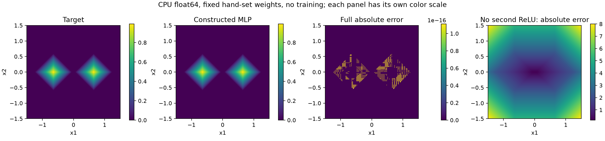
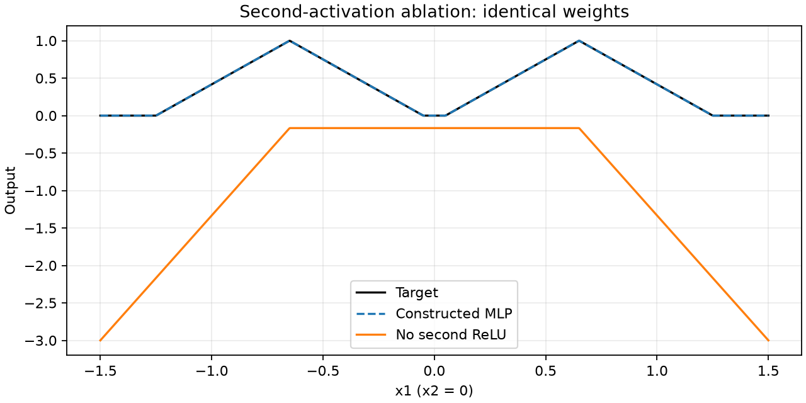

# 实验 1：双峰构造与第二层激活消融

2026-11-23 执行，T0010。使用已有学生 MLP 的前向实现，手动设置 [8,4] 网络的 65 个参数。无优化器、无反向传播、无训练；只比较完整构造与移除第二隐藏层 ReLU 的输出。该结果独立于课程八组训练结果，不修改统一报告。

## 构造与干预

对 c=-0.65、0.65，各用第一层四个单元得到 ReLU(x1-c)、ReLU(c-x1)、ReLU(x2)、ReLU(-x2)，其未缩放和记为 s_c。第二层前两个单元分别为 ReLU(1-s_c/0.6)，另外两单元置零；输出权重为 [1,1,0,0]，输出偏置为0。

完整网络直接调用已有 MLP.forward。消融仅绕过第二层激活，保留第一层 ReLU、全部线性层及同一组权重。每个 dtype 处理全部评价数据前后比较 state_dict，参数没有改变。

参考函数独立使用 NumPy L1 距离和最大值截断，不复用网络的隐藏层特征。float64 用于核对构造，float32 用于实际精度对照；参考值始终在网络实际接收、按相应 dtype 舍入后的坐标上计算。

## 环境与来源

| 项目 | 实际值 |
|---|---|
| 设备 / 线程 | CPU / 1；未使用 GPU |
| Python / PyTorch | 3.12.14 / 2.11.0+cpu |
| NumPy / Matplotlib | 2.5.3 / 3.11.2 |
| 评价集 | 课程训练点1024、课程网格4225、密网格40401、随机点10000、探针13、截面1001 |
| 新增随机点 | [-1.5,1.5]² 均匀采样，seed=20261123，不训练或选参 |
| 输出 | code/q1_neural_network/outputs_T0010_20261123_094728/ablation_exp1/ |
| 日志 | logs/T0010/T0010_20261123_094728/run.log |
| 脚本内部耗时 | 0.683秒，含计算/保存/绘图；不含解释器导入时间 |

从 LAB2 根目录执行的命令：

```powershell
& "$HOME/miniconda3/envs/ai26/python.exe" code/q1_neural_network/ablation_exp1.py --output code/q1_neural_network/outputs_T0010_20261123_094728/ablation_exp1
```

该目录已有结果，复现必须更换运行标识，不覆盖本次来源。完整精度数据、所有数组及手工参数分别在 results.json、predictions.npz、float64_weights.pt 和 float32_weights.pt 中；每个文件的来源和产物哈希见任务说明及 results.json。

## 数值结果

下表 MSE 参照独立目标函数，使用科学计数法保留微小误差，不将其误写为数学意义上的零。若后续报告统一用十进制，应保留足够位数。

| dtype / 评价集 | 完整构造 MSE | 完整最大绝对误差 | 消融 MSE | 消融最大绝对误差 |
|---|---:|---:|---:|---:|
| float64 / 课程训练点 | 4.94×10⁻³⁴ | 1.11×10⁻¹⁶ | 14.716408 | 7.847779 |
| float64 / 课程网格 | 0（本次数值计算） | 0（本次数值计算） | 15.721038 | 8.000000 |
| float64 / 201×201 密网格 | 3.16×10⁻³⁴ | 1.11×10⁻¹⁶ | 15.310010 | 8.000000 |
| float64 / 10000随机点 | 2.43×10⁻³⁴ | 1.11×10⁻¹⁶ | 15.297367 | 7.897063 |
| float32 / 课程训练点 | 3.76×10⁻¹⁶ | 1.07×10⁻⁷ | 14.716406 | 7.847778 |
| float32 / 课程网格 | 4.51×10⁻¹⁶ | 7.95×10⁻⁸ | 15.721037 | 8.000000 |
| float32 / 201×201 密网格 | 3.90×10⁻¹⁶ | 1.38×10⁻⁷ | 15.310009 | 8.000000 |
| float32 / 10000随机点 | 3.64×10⁻¹⁶ | 1.19×10⁻⁷ | 15.297365 | 7.897063 |

在密网格中，按独立目标 f≥0.5 定义的峰区有1600点，按 f=0 定义的背景有34001点。float64 消融的峰区 MSE 为1.843434、背景 MSE 为17.724209；完整构造背景误差为0。因此整体误差并非只来自峰顶，背景大量负输出也贡献了误差。支撑边界上的浮点余量可能使部分理论零点成为极小正值；本次子区域划分严格按数值参考执行，不加入额外阈值。

课程原始标签采用 float32 计算，与独立 float64 参考的最大差异为：训练点约0.0000001583、网格约0.0000000795。这解释了完整 float64 构造在课程网格上与独立参考完全一致、但对原始标签仍有微小误差的现象。

## 图像与探针



图1：201×201 密网格，CPU float64。目标与完整构造图一致；第三图误差色标量级为10⁻¹⁶，第四图消融误差最高为8。各面板使用自己的色标，不能只比较颜色深浅。完整网络实现局部双峰；消融后背景偏差显著。



图2：x2=0 的1001点截面。完整构造与目标重合；消融输出为负，在两峰之间形成平坦段，峰结构消失。两图均来自本次独立前向计算，不是原 D 组训练曲线或预测。

| 探针（float64） | 目标 | 完整构造 | 消融 |
|---|---:|---:|---:|
| (-0.65,0)、(0.65,0)，峰顶 | 1 | 1 | -0.166667 |
| (0,0)，峰间谷底 | 0 | 0 | -0.166667 |
| (-1.25,0)、(1.25,0)，支撑边界 | 0 | 0 | -2.166667 |
| (-1.5,-1.5)、(1.5,1.5)，背景角点 | 0 | 0 | -8.000000 |

## 解释与结论边界

第二层激活的作用是对每个峰分别截断负值，避免远离该峰时的负项继续进入总输出。移除它后，代数表达式变为

g(x)=2-(|x1+0.65|+|x1-0.65|+2|x2|)/0.6。

由三角不等式，|x1+0.65|+|x1-0.65|≥1.3，因此 g(x)≤-1/6。消融输出全为负与该代数结果一致；其大误差是这组干预的可解释后果，不代表程序失败。对两个 dtype，还核对了消融网络与折叠相邻线性层后的输出一致性。

本次结果支持：该两隐藏层网络存在能够实现目标的参数，且这组参数依赖第二层的逐峰截断。不能由此断言所有浅层网络都无法逼近目标，也不能把手工参数的成功解释成 Adam 必然学得到。有限网格与随机点只是数值检查；目标在任意点上的表达关系仍由逐层代数恒等式给出。

构造过程使用了题目的解析目标，不适用于未知目标的训练或泛化结论。消融后未重新优化参数，实验2的多初始化训练才能进一步讨论优化稳健性。

## 验证与后续

- float64 的完整输出误差阈值0.000000000001、float32阈值0.000002均通过；课程标签对照、有限性、权重未变和线性折叠检查均通过。
- 从保存权重重新加载，使用相同单线程/inference设置，密网格预测与归档逐元素一致；独立代数式与消融输出在预设容差内一致。
- 两张图已查看，坐标、图例和色标可读。实验2、3未运行，后续另行认领并提交Slurm，不自动扩展。
- 本任务待人工验收；应由本人核对构造、边界解释及结果后再决定是否并入统一报告。
