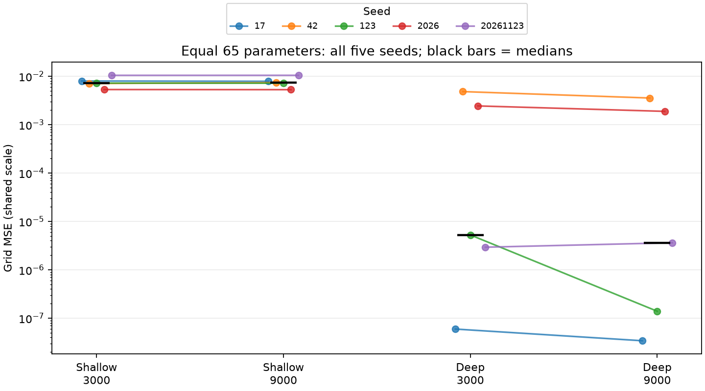
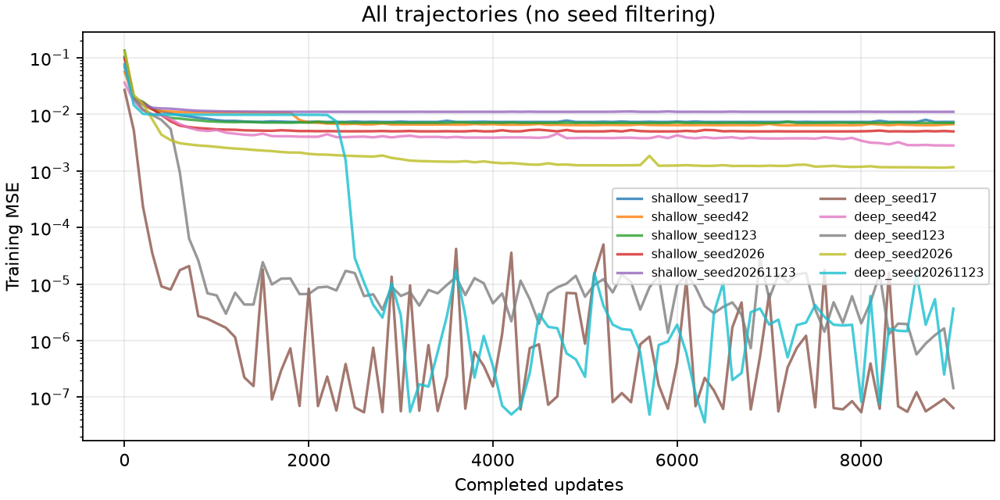

# 实验 2 结果：结构优势、初始化差异与训练预算

Job188223的两种65参数网络、五个种子、10条连续Adam轨迹全部完成，30个快照与20条非零预算结果核验通过。**在本次全部种子和两个预算下，两隐藏层网络的网格误差均低于浅层网络；但初始化仍影响能否达到很低误差，延长训练也不保证改善。** 本记录属于T0012，不修改T0011提交准备或统一报告的待验收基线。

## 来源与核验

| 项目 | 真实来源 |
|---|---|
| 日期 / 作业 | 2026-11-23，Job188223 |
| 原始输出 | code/q1_neural_network/outputs_T0011_20261123_110926_188223/ablation_exp2/ |
| 源码commit | a20c18837df36a50dc69fcde90bea094d48e9481 |
| 设备 / 精度 | NVIDIA A100-SXM4-80GB，float32，单线程，TF32关闭，确定性算法开启 |
| 环境 | Python3.12.15，torch2.11.0+cu128，CUDA12.8，NumPy2.5.3 |
| 训练 | [16]与[8,4]，各65参数；五种子17/42/123/2026/20261123；Adam，lr=0.01，连续9000步 |
| 数据 | 原1024训练点、4225评价点；数据哈希与预设一致 |
| 作业内部耗时 | 174.957秒；不含排队和完整sbatch启动时间 |
| 本地分析 | outputs_T0012_20261123_112554/analysis/，位于code/q1_neural_network下 |

收到的verification.json中71个文件哈希全部匹配；5个源码快照的哈希正确，与本地文件在统一LF后相同。models.py/train.py跨平台字节差异仅为换行，未发现实现差异。

原检查器在完整副本上重新执行并通过，原目录72个文件的哈希前后不变。另用30份保存权重在本地CPU重新前向，预测与归档CUDA预测符合rtol=0.0001、atol=0.00002，实测最大绝对差约0.00000203；没有重新训练。Adam状态计数、步数、模型结构、预测及误差指标均核对。

从本地同种子重建初值时，Windows CPU结果与集群保存初值并非逐位相同，最大差约0.0000000596，小于float32机器精度0.0000001192；初值验证采用该浮点容差，分析以保存权重为准。该结果不提供跨平台训练轨迹逐位复现的保证。

未在本机找到本作业job.log及Slurm.out/.err。本次设备、耗时与完成状态依据产物manifest，不声称核对过调度器退出状态或原始终端日志。

## 1. 固定预算下的跨种子对比

| 结构 | 更新次数 | 网格MSE中位数 | 最小值 | 最大值 | 均值 |
|---|---:|---:|---:|---:|---:|
| 浅层[16] | 3000 | 0.00720733 | 0.00530622 | 0.01043422 | 0.00759638 |
| 浅层[16] | 9000 | 0.00737081 | 0.00527332 | 0.01044345 | 0.00762367 |
| 两隐藏层[8,4] | 3000 | 0.0000052483 | 0.0000000597 | 0.00481281 | 0.00145090 |
| 两隐藏层[8,4] | 9000 | 0.0000036203 | 0.0000000342 | 0.00354706 | 0.00108600 |

3000步时，深层最差值0.00481281仍低于浅层最好值0.00530622；9000步时同样存在范围分离（0.00354706<0.00527332）。这比仅比较同编号种子更强，但仍只涵盖预先选定的五种初始化。

中位数之比约为1373倍和2036倍，但不能把它解释为每次深层都改善千倍：两个深层种子的误差仍在0.001–0.004区间，所以均值明显高于中位数。应同时展示散点、范围和均值，不只选最好的深层结果。



图1：所有五个种子，统一对数纵轴，黑短线为中位数。每条连线仅连接同结构同种子的3000/9000步；结构间不连线，因为同种子不代表相同初始参数。此图由本地已核验指标绘制，原作业paired_budgets.png的两子图采用各自纵轴范围，不能直接用视觉高度比较结构。

## 2. 延长预算是否有效

以下为完整20条预算结果。改善率=(MSE3000-MSE9000)/MSE3000，正值表示改善，负值表示变差。

| 结构 | seed | 3000步网格MSE | 9000步网格MSE | 改善率 |
|---|---:|---:|---:|---:|
| 浅层 | 17 | 0.00797074 | 0.00786075 | +1.38% |
| 浅层 | 42 | 0.00706338 | 0.00737081 | -4.35% |
| 浅层 | 123 | 0.00720733 | 0.00717001 | +0.52% |
| 浅层 | 2026 | 0.00530622 | 0.00527332 | +0.62% |
| 浅层 | 20261123 | 0.01043422 | 0.01044345 | -0.09% |
| 深层 | 17 | 0.0000000597 | 0.0000000342 | +42.63% |
| 深层 | 42 | 0.00481281 | 0.00354706 | +26.30% |
| 深层 | 123 | 0.0000052483 | 0.0000001392 | +97.35% |
| 深层 | 2026 | 0.00243343 | 0.00187916 | +22.78% |
| 深层 | 20261123 | 0.0000029317 | 0.0000036203 | -23.49% |

浅层只有3/5种子改善，且改善率均不超过1.38%；另2个变差，整体均值和中位数略升。深层4/5改善，seed123改善较大，但seed20261123的终点误差上升。不能仅用“深层中位数下降”替代逐轨迹预算比较。



图2：原始作业training.png的逐字节副本，包含全部10条训练曲线、每100步记录，纵轴对数。部分低误差轨迹存在反弹，因此9000步不必优于3000步；没有按最低验证误差挑快照。深层42/2026虽低于浅层，训练误差仍维持相对高位。

seed20261123深层的训练MSE也从0.0000027725升到0.0000036783；浅层42的训练MSE从0.00661989升到0.00671698。因此这些终点变差不能只解释为“训练误差持续下降而泛化变差”的过拟合，当前记录与优化轨迹波动相容，但没有单独干预学习率来确定原因。

## 3. 平均误差与局部误差

| 结构 / 9000步 | 峰区MSE中位数 | 背景MSE中位数 | 最大绝对误差中位数 | 最大绝对误差范围 |
|---|---:|---:|---:|---|
| 浅层 | 0.04856621 | 0.00517986 | 0.420897 | 0.313303–0.576769 |
| 深层 | 0.0000248301 | 0.0000001102 | 0.011844 | 0.001924–0.426280 |

峰区按原标签f≥0.5划分，共170点；背景按f=0划分，共3599点。每一列中位数独立统计，不能把这一行当成同一个“代表种子”。网格其余点为非背景但低于0.5的区域。

深层seed42的网格MSE从0.00481281降到0.00354706，但最大绝对误差从0.394152升到0.426280；seed2026也有类似分化。相反，深层seed20261123的平均MSE上升，而最大绝对误差从0.024783降到0.011844。平均误差与最坏局部误差衡量不同性质，不应仅依据一个指标称“所有方面都更好”。

## 4. 代价与结论

同为65参数，9000步累计耗时中位数分别为浅层13.588秒、深层20.740秒。深层有更多顺序算子与层级，参数量相同不意味着每步耗时相同；计时包含评价与此前快照I/O，不能据此给出纯训练算力比例。第一条浅层初始测量约1.81秒，其余初始测量约几毫秒，存在启动开销，不应无说明地比较单个候选时间。

本实验支持三点：

1. 在当前固定数据、初始化规则、Adam学习率及两个预算下，深层网络的优势跨五个种子存在，原课程D组的好结果并非本次对照中唯一的低误差实例。
2. 深层并非总能学到实验1的近精确构造。9000步时，seed42/2026仍有明显残差，初始化与优化轨迹影响最终质量；“存在可表达参数”不同于“指定优化器总能找到”。
3. 对浅层单纯将预算扩大三倍，未在这些种子上带来明显、统一的改善；但这仍不能证明其误差平台完全由表达能力导致。不同初始化、优化器、学习率或宽度可能改变结果，不能将本实验扩展为浅层网络的不可能性证明。

此处改变的是深度与宽度分配共同构成的结构，不能将收益归因于一个脱离结构的“层数”标量。五个种子是预先选择的重复试验，不是总体分布的充分样本，不给置信区间或普遍成功率。GPU结果与原CPU课程结果应分开列明环境，不把设备差异隐藏在同一表中。

## 复现与接续

从LAB2根目录运行，只读原目录并在新输出中核验/绘图：

```powershell
& "$HOME/miniconda3/envs/ai26/python.exe" code/q1_neural_network/analyze_ablation_exp2.py --input code/q1_neural_network/outputs_T0011_20261123_110926_188223/ablation_exp2 --output code/q1_neural_network/outputs_T0012_<新标识>/analysis
```

尖括号换成新运行标识，输出目录不能已存在。本次正式分析目录为outputs_T0012_20261123_112554/analysis，包含analysis.json、paired_changes.csv、检查器副本及日志。原输出保留不变，关键哈希见docs/tasks/T0012.md。

结果待人工验收。后续可以先并入报告的拓展讨论；若继续研究优化原因，应预先设定新的干预，例如对相同保存初值比较学习率，再提交独立Slurm任务。当前不自动启动实验3或追加训练。
