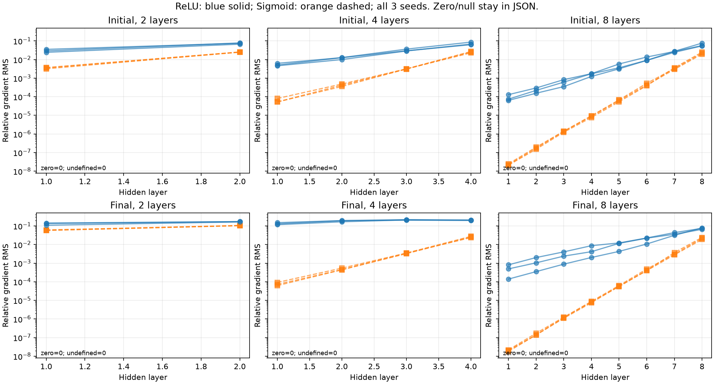
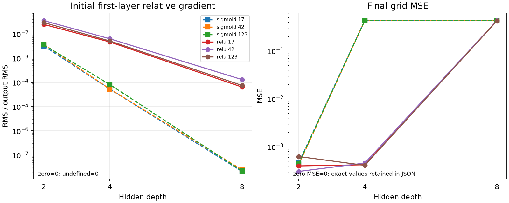

# 实验 3 结果：激活改善梯度传播，但不保证深网络训练成功

Job188349完成了2/4/8层、Sigmoid/ReLU、三个种子的18条轨迹。9组共享Linear初值和36份首尾快照核验通过。**本次Sigmoid随深度增加出现明显前层梯度衰减；ReLU改善了传播，但默认初始化下8层ReLU仍未学好目标。** 这支持激活影响梯度传播，也限定了“换ReLU就能解决训练困难”的适用范围。

本记录属于T0014，独立于课程八组结果及待验收统一报告，不修改T0013提交准备。所有结论取自实际保存结果，不补做训练、不按结果筛种子。

## 1. 来源与验证

| 项目 | 实际记录 |
|---|---|
| 日期 / 作业 | 2026-11-23，Job188349 |
| 原始输出 | code/q1_neural_network/outputs_T0013_20261123_122232_188349/ablation_exp3/ |
| 源码commit | 74cbf548059a1e7350fd7e6cd7216491833c881a |
| 环境 | Python3.12.15，torch2.11.0+cu128，CUDA12.8，NumPy2.5.3 |
| 设备 / 精度 | A100-SXM4-80GB，float32，单线程，确定性算法，TF32关闭 |
| 数据 | 1024固定训练点，4225网格；诊断固定为训练集前128点 |
| 训练 | 每层32单元；种子17/42/123；SGD、lr=0.05、1000步 |
| 配对 | 同深度同种子的两种激活严格共享同一份CPU Linear初值 |
| 内部耗时 | 137.111秒，包含轨迹诊断/保存等，不含Slurm排队 |

收到的verification.json中113项哈希全部匹配，8个源码快照的哈希正确，与当前代码统一LF后相同。原检查器在完整副本上运行通过，原目录114个文件哈希前后不变。首尾36份模型在本地CPU重算：预测最大绝对差0.0000004768，逐层梯度RMS最大绝对差约0.0000000000582，相对梯度最大相对差约0.0000002664，均在预先设定的复核容差内。

核验无训练更新；没有使用本机GPU。原始job.log及Slurm.out/.err本次未在工作区找到，运行设备/耗时依据manifest，不声称复核过调度器退出状态。ρ为0或null的记录数均为0，没有因对数绘图而剔除记录。

## 2. 拟合结果：ReLU的优势存在边界

| 深度 | 参数量 | 激活 | 最终网格MSE中位数 | 最小值 | 最大值 |
|---|---:|---|---:|---:|---:|
| 2 | 1185 | Sigmoid | 0.00044194 | 0.00041949 | 0.00046108 |
| 2 | 1185 | ReLU | 0.00039886 | 0.00030604 | 0.00062581 |
| 4 | 3297 | Sigmoid | 0.42953890 | 0.42949496 | 0.42958187 |
| 4 | 3297 | ReLU | 0.00042096 | 0.00041004 | 0.00045694 |
| 8 | 7521 | Sigmoid | 0.42982140 | 0.42982137 | 0.42982141 |
| 8 | 7521 | ReLU | 0.42807794 | 0.42415128 | 0.42940750 |

2层两种激活都能训练，ReLU并非每个种子都更好：seed123的MSE为0.00062581，高于对应Sigmoid的0.00044194。4层三组配对中ReLU均明显优于Sigmoid。8层ReLU虽有改善，但全部种子的误差仍很高，不能称训练成功或已解决梯度问题。

为解释误差约0.43的含义，增加一个只读诊断基线：用训练标签均值-0.01157117作为所有输入的固定预测，不拟合网络。其训练MSE为0.41774955，网格MSE为0.42982139。

8层Sigmoid的网格MSE几乎等于该常数基线，预测标准差仅约0.0000000233–0.0000000438。8层ReLU相对常数基线的误差降低分别只有0.096%、0.406%、1.319%；预测标准差为0.000332–0.004394，而目标标准差为0.655506。它们都没有恢复目标的主要变化幅度，ReLU并不是已经拟合良好而只是MSE数字偏大。基线只解释现象，不参与选种子或调整实验。

## 3. 梯度证据：ReLU衰减较弱，但仍可能很弱

下表为三个种子的首层相对梯度ρ中位数；绝对RMS与输出端RMS另在后表及完整JSON中保留。

| 深度 | 激活 | 初始ρ | 最终ρ | 初始首层绝对RMS中位数 |
|---|---|---:|---:|---:|
| 2 | Sigmoid | 0.00351047 | 0.05814850 | 0.0000334302 |
| 2 | ReLU | 0.02907487 | 0.13608322 | 0.0002710956 |
| 4 | Sigmoid | 0.0000527145 | 0.0000723320 | 0.0000005154 |
| 4 | ReLU | 0.00506414 | 0.13030994 | 0.0000480843 |
| 8 | Sigmoid | 0.0000000221 | 0.0000000204 | 0.0000000002447 |
| 8 | ReLU | 0.0000743727 | 0.0004921926 | 0.0000007048 |

Sigmoid初始首层ρ从2层约0.00351降到8层约0.0000000221，降低约五个数量级；4/8层训练后仍保留明显的层间斜率，支持前层传播信号弱的判断。

ReLU的初始首层ρ也从2层约0.0291降到8层约0.0000744。虽然8层ReLU比Sigmoid大很多，但相对输出端仍很弱，不能把“相较Sigmoid改善”换成“梯度已经足够”。4层ReLU在训练后层间相对梯度较平坦，8层仍有较强斜率，与两者拟合差异相容。



图1：蓝色实线ReLU、橙色虚线Sigmoid；每种情况包含全部三个种子，统一纵轴。上行为初始，下行为1000步；每个面板保留0/null数量，本次均为0。曲线不是只取最佳种子。



图2：左图为所有种子的初始首层ρ随深度变化，右图为最终网格MSE。初始传播改善与最终拟合不是同一指标：8层ReLU的ρ高于Sigmoid，但两者最终误差仍接近常数基线。

## 4. 相对梯度变大不等于绝对梯度变大

以2层Sigmoid的seed17为例：

| 指标 | 初始 | 最终 |
|---|---:|---:|
| 首层ρ | 0.00318375 | 0.05748058 |
| 首层绝对RMS | 0.0000301768 | 0.0000150607 |
| 输出端绝对RMS | 约0.00947839 | 约0.00026201 |

ρ增加约18倍，但首层绝对梯度约减半；输出端RMS减小约36倍，分母下降得更多。该轨迹训练良好、残差缩小，不能根据最终ρ更大就称“首层绝对梯度增强”。跨模型比较时也应同时查看输出端梯度和损失。

## 5. 局部导数、权重与不活跃单元

8层Sigmoid初始各层的平均局部导数约0.2337–0.2465，并未接近0；不能把现象简单描述为“所有单元都严重饱和”。多层导数与权重矩阵连乘是合理机制解释，但导数上界0.25本身不是整体梯度必然衰减的证明。

8层ReLU平均局部导数约0.375–0.625，仍有大量激活路径；但诊断批次中不同隐藏层可有12.5%–62.5%的单元始终不激活（最终三个种子层间范围）。这些统计与传播能力有关，却不足以独立断言不活跃单元是训练失败的唯一原因。尤其“这128点不活跃”不等于整个输入域上永久死亡。

初始化隐藏层权重Frobenius范数约3.17–3.40，已完整记录；它不是完整Jacobian或谱范数，不能直接由它推导梯度必然放大/缩小。跨深度还同时改变参数量和多个权重乘积，不是等参数量的纯深度干预。

## 6. 与课程原实验的关系及结论

本拓展使用PyTorch默认随机初始化，不加载课程提供的Linear初值；同时记录了GPU/float32/确定性设置，不能当成原课程CPU八组的逐位重跑。原课程8层ReLU拟合较好而本次8层不佳，提示激活效果的结论依赖初始化与训练设置；由于两次实验同时存在初始化和设备等区别，不能据此唯一归因于初始化。

本次支持：当前SGD/lr/1000步下，Sigmoid的4/8层网络存在明显前层传播困难；4层ReLU改善了梯度传播与拟合；ReLU的8层结果则说明它并不保证训练成功。该判断基于同深度、同种子、完全相同Linear初值的配对对照，并结合绝对/相对梯度和常数基线。

三个种子不提供普遍成功率、置信区间或“所有深网络”的定理。没有独立改变学习率、初始化尺度、优化器或训练预算，不能判断哪一种后续改动一定能修复8层ReLU。若继续研究，应另行预设干预并提交Slurm，不在看到结果后悄悄换种子或重调本实验。

## 复现与交付

从LAB2根目录运行，输出使用新标识：

```powershell
& "$HOME/miniconda3/envs/ai26/python.exe" code/q1_neural_network/analyze_ablation_exp3.py --input code/q1_neural_network/outputs_T0013_20261123_122232_188349/ablation_exp3 --output code/q1_neural_network/outputs_T0014_<新标识>/analysis
```

本次分析目录为outputs_T0014_20261123_123146/analysis，含analysis.json、检查器副本、日志及精选图来源；完整哈希与验证范围见docs/tasks/T0014.md。结果待人工验收，不自动写入统一报告。
