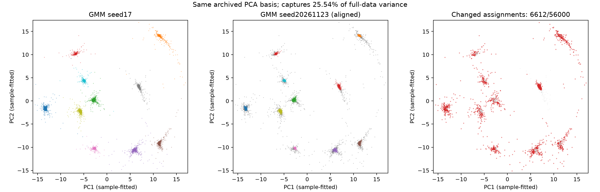
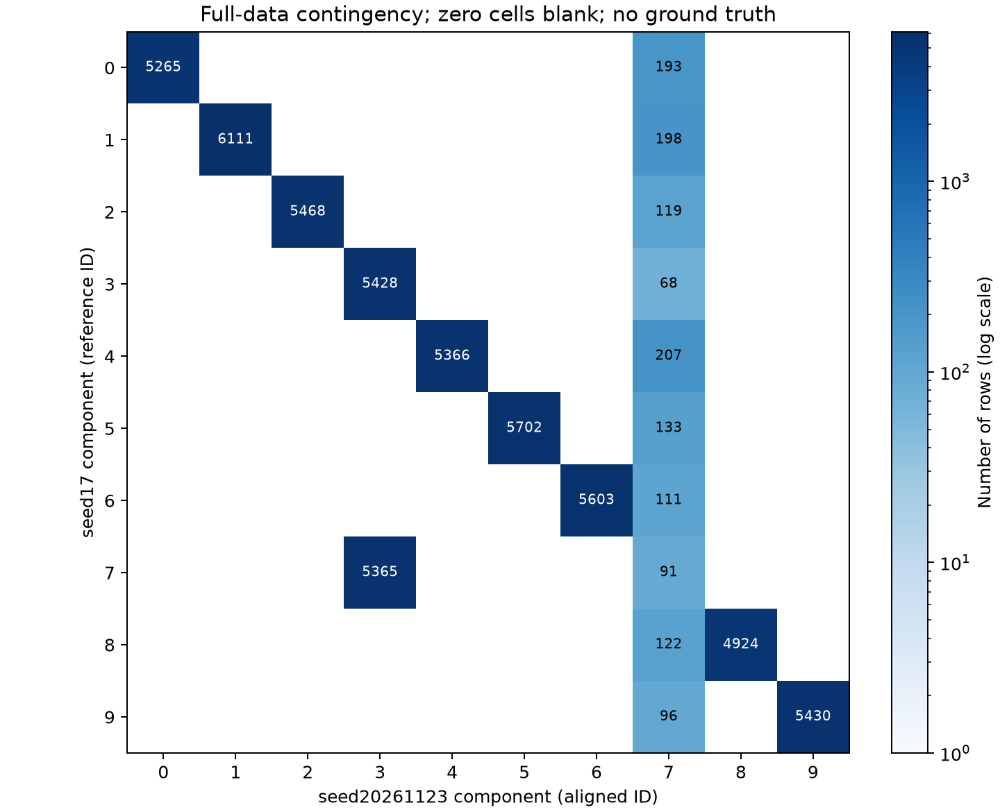
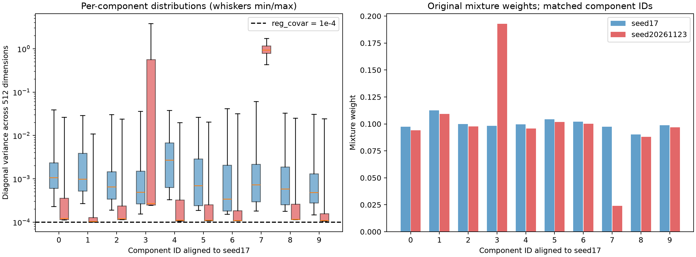
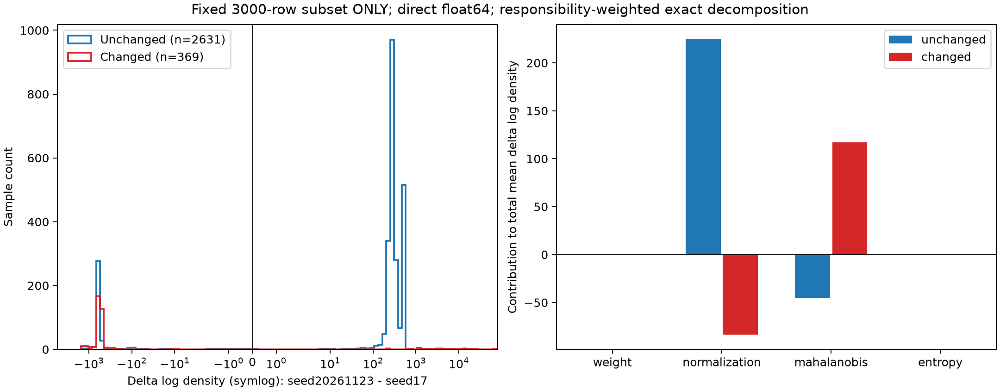

# GMM 高似然与较差几何分区：诊断及冻结干预

2026-11-25，T0023。已完成归档分区、参数与 PCA 的轻量分析，以及固定 3000 行的 CPU 密度核验。全量 CUDA 核验和冻结干预脚本已备好，**尚未提交集群**；主报告、正式标签和原模型保持现状。

## 比较对象与口径

比较 P2 Job190299 保存的两组 K=10 GMM 最佳重启：seed17 与 seed20261123。前者只作常规分区参照，不是真实标签。

| 原 P2 作业结果 | seed17 | seed20261123 |
|---|---:|---:|
| 全量 float32 CUDA 平均对数似然 | 1083.010254 | 1330.575073 |
| Silhouette，固定 3000 行 | 0.961279 | 0.819941 |
| CH，全量 | 2325424.25 | 42917.449219 |
| DB，全量 | 0.054132 | 1.279419 |

特征为原始 56000×512 float32，无标准化。本表来自原归档，不是本次 CPU 重算。Silhouette 继续使用 seed20261011 无放回抽取的同一批 3000 行，距离仅在子集内部计算；CH/DB 正式口径是全量原始空间。

本地最终输出为 `code/q2_clustering/outputs_T0023_local_20261125_03/`。01/02是之前的绘图/诊断版本，均保留；03在正式干预中补充分配基准与归档指标回放差异记录，精选图来自03。

## 分区发生了什么

按最大重叠匹配簇编号后，两 GMM 分区有 **6612/56000（11.807%）** 不同，ARI=**0.8761956733**；固定子集有369/3000不同。此前P2的6610是异常GMM对KMeans，参照不同。



复用T0020的PCA：在固定3000行拟合，仅中心化，投影全量；捕获全量方差约25.54%。不能用二维距离替代512维指标。



列联表显示两种结构变化：

- 异常模型原始成分4（对齐后编号3）有10793行，其中 **5428行来自常规簇3，5365行来自常规簇7**，两个原本分开的常规簇进入同一成分。
- 异常模型原始成分1（对齐后编号7）有 **1338行**，来自全部十个常规簇，分别为193、198、119、68、207、133、111、91、122、96。
- 其余成分主要保留各自对应的常规簇，变化不是单纯编号重排。

合并分开的点群，以及把分散样本放入共同簇，都可能增加簇内欧氏离散程度。这提供了几何指标恶化的结构解释；没有真实标签，不能把改变归属称为分类错误。

## 参数为何允许这种分区



箱体统计各成分512个对角方差，须线为最小/最大，纵轴对数；编号按常规分区对齐，仅为展示。

| 参数统计 | 常规模型 | 异常模型 |
|---|---:|---:|
| 全部对角方差中位数 | 0.000743723 | 0.000125705 |
| 方差低于2×reg_covar的比例 | 7.8125% | 59.3164% |
| 最大对角方差 | 0.0611658 | 3.84017 |

reg_covar=1e-4。异常模型原始成分1的维度方差中位数约 **0.937078**、权重约 **0.023893**，它正是接收1338行的跨常规簇成分。合并两簇的原始成分4权重约 **0.192732**，维度方差跨度也很大；多个其余成分方差集中在正则项附近。

这些参数与“多个窄成分描述集中区域，宽成分接收分散样本”的密度结构相符。这里的窄/宽描述保存参数的相对大小，**没有证明协方差趋于零、奇异塌缩、过拟合或未知样本泛化能力**。

## 同数据数值核验与似然来源

直接用float64计算 `(x-mu)^2/v`，避免展开成三个大数后相减。先比较**同一固定子集**上的原float32 E-step与直接float64，防止把抽样差异误当成数值误差。

| 同一3000行 | 原float32 CPU平均似然 | 直接float64 CPU平均似然 | 前者减后者 | 分配不同数 |
|---|---:|---:|---:|---:|
| 常规模型 | 1106.017944 | 1106.020566 | −0.002622 | 0 |
| 异常模型 | 1319.228638 | 1319.239076 | −0.010439 | 0 |

两组直接float64分配也分别与归档子集完全一致。子集平均似然优势 **213.218510** 明显大于该次精度比较的差异，支持子集优势不只是原E-step的float32舍入造成。**不能据此替代全量GPU核验，或排除原拟合过程的数值影响。** 子集优势与原全量优势247.564819统计范围不同，不能拿两者之差估算精度误差。

记 Δℓ=log p_special(x)−log p_normal(x)：

| 子集样本组 | 行数 | Δℓ均值 | Δℓ中位数 | Δℓ>0比例 | 对全部3000行均值的贡献 |
|---|---:|---:|---:|---:|---:|
| 归属未变 | 2631 | 204.710578 | 275.776460 | 86.3170% | 179.531177 |
| 归属改变 | 369 | 273.880758 | −553.039756 | 10.5691% | 33.687333 |
| 全部 | 3000 | 213.218510 | 271.970318 | 77.0000% | 213.218510 |

贡献是该组Δℓ总和除以全部3000。改变组大部分样本密度下降，少量很大的正改变量使组均值为正；不能由组均值推断多数点受益。

以各自模型的责任度r精确分解每点密度：

\[
\log p(x)=\sum_k r_k\log\pi_k
-\frac12\sum_k r_k\sum_d\log(2\pi v_{kd})
-\frac12\sum_k r_k\sum_d\frac{(x_d-\mu_{kd})^2}{v_{kd}}
+H(r).
\]



分别计算两模型的四项再作差。对子集平均优势213.218510，权重项贡献 **+0.075619**，对数归一化项 **+141.238753**，马氏距离项 **+71.904139**，熵项约零。未变组主要由归一化项获益（+224.775847），马氏项部分抵消（−45.290035）；改变组归一化项下降（−83.537095），马氏项提高（+117.194174）。这些贡献均以全部3000行为分母。

这支持一种密度解释：窄方差提高集中区域密度，宽成分减轻部分样本的标准化距离惩罚，同时硬分区的欧氏几何可以变差。但两原模型的均值、权重、方差都不同，这个分解**不是各参数独立的因果效应**，还需固定均值干预。

## 已固定的全量干预（待运行）

冻结异常模型均值和未被干预的参数，不执行EM、KMeans或参数再估计：

| 设置 | 权重 | 协方差 |
|---|---|---|
| original | 保存原值 | 保存对角方差 |
| uniform_weights | 全部1/10 | 保存对角方差 |
| shared_sphere | 保存原值 | 全部s²I |
| uniform_shared | 全部1/10 | 全部s²I |

标量只由异常模型原参数计算，评估效果前写入protocol.json，未按效果挑选：

\[
s^2=\frac{\sum_k\pi_k\sum_d v_{kd}}{D\sum_k\pi_k}
=0.1263528717162454.
\]

Slurm A100上先全量比较两模型的直接float64密度与原float32 E-step，再以直接float64 argmax对四设置分配。保存逐点分解、标签、平均似然、ARI、对齐变化数、实际非空簇数和三指标；两组归档标签也同次评价作环境回放对照。几何指标沿用原float32 CUDA实现，Silhouette同一3000行、CH/DB全量。float64原始设置若与归档分配不同，会单列差异，不能混入干预效应。

双干预等价于**最近冻结均值分配**，脚本独立验证；没有更新均值，不能称为训练好的KMeans。均值已受原EM影响，因此干预后未恢复几何指标，也不能证明方差在原拟合中无作用。共享球形化同时消除方向差异和成分尺度差异，本实验不单独区分二者。

## 复现与集群交接

LAB2根目录，本地轻量复现须选新输出目录：

```powershell
& 'C:/Users/35150/miniconda3/envs/ai26/python.exe' -m unittest discover -s code/q2_clustering/tests -p test_gmm_anomaly.py -v
& 'C:/Users/35150/miniconda3/envs/ai26/python.exe' code/q2_clustering/gmm_anomaly.py local --output code/q2_clustering/outputs_T0023_local_new
```

用户自行push本任务提交后，在集群手工执行。必须保留原Job190299的 `p2/experiment/`（含两候选model/labels/fit、runs/config/plan/diagnostic_indices）与相邻 `p2/source_snapshot/`，原始输出不随Git传输；全量作业不依赖T0020的PCA输出。

```bash
cd ~/USTC-AI3002-26fall
git pull --ff-only
cd LABs/LAB2/code/q2_clustering
test -f outputs_T0016_20261123_224500_190299/p2/experiment/candidates/gmm_k10_seed20261123/model.npz
test -f outputs_T0016_20261123_224500_190299/p2/source_snapshot/submission.py
sbatch run_gmm_anomaly_T0023.sbatch
squeue -u pb25030753
```

资源：stu/Students/qos_stu_default、A100×1、4 CPU、16G、30分钟、ai26。脚本断言CUDA/A100、禁止CPU回退，Python正式入口要求Slurm allocation。每次新建 `outputs_T0023_<时间戳>_<jobid>/diagnosis/`，不覆盖。日志归档 `LABs/LAB2/logs/T0023/<时间戳>_<jobid>/`，含job.log和out/err；应核对ALL DONE与非零退出情况，不能只看任务从队列消失。

取回整个本次输出和日志（本地PowerShell，替换标识）：

```powershell
scp -r 'ustc:~/USTC-AI3002-26fall/LABs/LAB2/code/q2_clustering/outputs_T0023_<时间戳>_<jobid>' code/q2_clustering/
scp -r 'ustc:~/USTC-AI3002-26fall/LABs/LAB2/logs/T0023/<时间戳>_<jobid>' logs/T0023/
```

正式产物含summary、protocol、density_indices、point_diagnostics、intervention_labels、密度/干预图、source_snapshot和artifact_hashes。回收后先核对哈希、退出状态、两原模型回放及分配差异再分析。失败保留部分产物；指标失败会在summary留痕并非零退出。

## 验证与来源

源码与P2快照逐项核对，允许LF/CRLF差异，内容漂移即拒绝执行；运行前后核对输入未变。特征SHA256为 `a07578f6e1ab9d17667b987b25b1b9bc1f06a5f1f678a127e31dc78bc5ff0b38`，索引为 `70d72e904d21c308ec6d82b35d9dbbfe4b79a16c2d317305205726bb0ed5b60a`。本地03 summary为 `82cccb4cfa7f823c2badbf4796af0dc59823a46257bd430539cbb1209a217fa2`；其余输入、快照与产物哈希见输出summary/protocol/artifact_hashes。

本地Python3.12.14、torch2.11.0+cpu、numpy2.5.3，03计算约5.18秒，不含Python启动。6项toy测试通过，覆盖SciPy密度对拍、逐点责任度分解、大偏移稳定计算、最近冻结均值等价、置换/贡献守恒和非法方差；其中用6行合成数据、模拟Slurm与设备选择，在CPU实际走通密度、六组评价、等价校验和哈希归档流程，不执行真实GPU。四图已逐张检查。

Slurm通过bash -n；隔离替身检查了提交目录缺失、conda缺失/激活失败、GPU检查失败、Python失败、tee失败、全部替身成功，退出码符合预期。非Slurm调用正式run被拒绝且不创建输出。替身不执行GPU/正式数据，不能算作全量实验完成。

尚无全量干预结果，无重训、真实标签、隐藏ACC或泛化结论。任务与验收见 [T0023](../tasks/T0023.md)。
