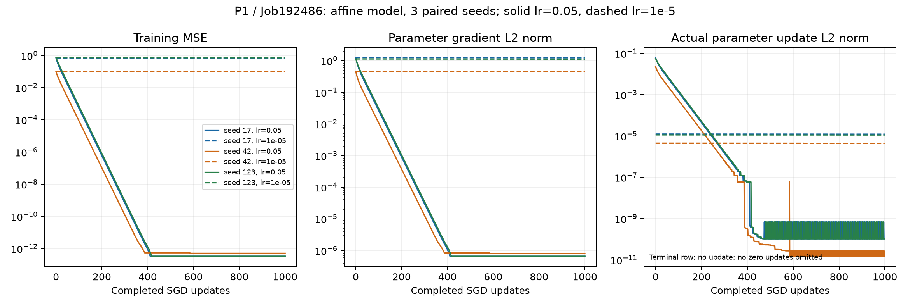
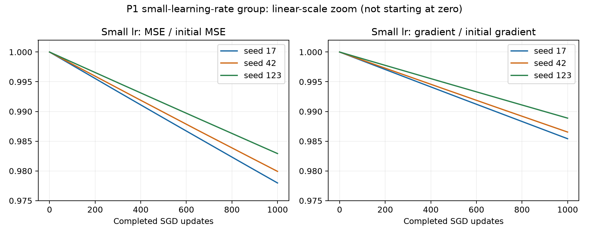

# P1结果：损失下降慢，并不足以诊断梯度消失

2026-11-24，T0019，codex。正式来源 **Slurm Job192486**，`code/q1_neural_network/outputs_T0018_20261124_105849_192486/`；六条轨迹已完成并取回核验，待人工验收。

**本实验支持预定反例。** 对没有隐藏层的3参数线性模型，仅把学习率从0.05降至0.00001，1000步后损失仅下降1.71%–2.20%，梯度范数仍有初始值的98.54%–98.89%；相同初值的正常学习率组训练MSE约为3.25e-13至4.96e-13。因此，梯度仍明显时也可能因更新太小而慢收敛，不能仅凭MSE曲线判定梯度消失。

## 1. 运行来源与核验

设计保持[P1执行说明](p1_learning_rate.md)的事前设置：`nn.Linear(2,1)`、偏置共3参数，无隐藏层；课程gradient固定1024训练点、4225网格点；全批量平均MSE、SGD无动量/无衰减；种子17/42/123配对学习率0.05与1e-5，均严格1000次更新。

环境记录：A100-SXM4-80GB、Python3.12.15、torch2.11.0+cu128、NumPy2.5.3、float32、单线程、确定性算法、TF32关闭。正式运行版本 `47ae4d00e3a81545c14db56936eb4544c694f62b`，与T0018准备提交相符。

- 六轨迹、各1001行，共6006状态行、6000次正式SGD更新；末行仅测量。
- 33项封存文件哈希全部匹配；五份源码/配置/作业快照统一CRLF/LF后与本地一致。
- CPU float64独立公式审计全历史MSE、参数梯度、SGD递推及实际更新；首尾权重、网格预测、配对初值及最小二乘参考通过。
- 最大参数梯度绝对差 `1.1966832e-7`，在事前检查容差内；本地与集群检查报告的对应字段一致（允许跨平台浮点舍入）。
- 原运行目录35个文件分析前后哈希不变；没有重新拟合、GPU运行或修改原产物。

本地完整复算位于 `code/q1_neural_network/outputs_T0019_20261124_02/`，包含 `analysis.json`、六轨迹汇总 `trajectories.csv`、指定步数表 `selected_steps.csv` 及新检查报告。原Slurm `job.log/.out/.err` 未取回，无法核对完整作业日志、调度器记账退出码或墙钟耗时；完成与环境依据封存manifest及产物记录。

## 2. 首步控制：相同梯度，更新量相差约5000倍

每个种子两组的首参数、首训练MSE和首梯度向量均完全一致；这排除了初值不同对首步比较的影响。

| 种子 | 相同的首梯度L2范数 | lr=0.05实际首更新 | lr=1e-5实际首更新 | 实际比例 |
|---|---:|---:|---:|---:|
| 17 | 1.247021 | 0.0623511 | 1.24623e-5 | 5003.16 |
| 42 | 0.448766 | 0.0224383 | 4.49948e-6 | 4986.86 |
| 123 | 1.133284 | 0.0566642 | 1.13395e-5 | 4997.05 |

数学上SGD为 `theta_next = theta - lr * gradient`，学习率比例为5000。真实float32参数差的比例略有偏离，这是舍入效应；独立参数递推检查已通过。这里的梯度是三个参数对训练MSE的整体L2范数，不是原深层实验的隐藏层梯度RMS或归一化rho。

## 3. 1000步后的损失与梯度

| 种子 | 初始训练MSE（配对相同） | lr=0.05终训练MSE | lr=1e-5终训练MSE | 小lr训练MSE下降 | 小lr终梯度 / 首梯度 |
|---|---:|---:|---:|---:|---:|
| 17 | 0.695703 | 3.25269e-13 | 0.680379 | 2.2027% | 98.5418% |
| 42 | 0.0990445 | 4.96435e-13 | 0.0970556 | 2.0080% | 98.6537% |
| 123 | 0.743585 | 3.24903e-13 | 0.730884 | 1.7080% | 98.8880% |

| 种子 | lr=0.05终网格MSE | lr=1e-5终网格MSE | 小lr终梯度范数 |
|---|---:|---:|---:|
| 17 | 3.35897e-13 | 0.683240 | 1.228838 |
| 42 | 5.15269e-13 | 0.100537 | 0.442724 |
| 123 | 3.35679e-13 | 0.758783 | 1.120682 |

来源为Job192486六份完整history.csv；实线lr=0.05、虚线lr=1e-5，颜色区分种子；三图纵轴均为对数。右图只绘实际执行更新的step0…999，末行无更新；本次没有零更新被省略。正常组后期实际更新的小幅跳动应结合float32参数舍入理解，不等于损失显著变坏。

第二图仅放大小lr组三条轨迹，纵轴从0.975开始，已在标题标明；用于显示约2%的损失变化及约1%的梯度变化，不能把截断纵轴误读成从零开始的大幅变化。

小lr组的终梯度为0.4427–1.2288，仍保留98%以上首梯度；最后一次实际更新也仍只有约4.42e-6–1.23e-5。它们没有发生参数完全不变：1000次更新均非零，但总优化进展有限。与之相比，正常组约400步前后进入极低误差区，1000步终梯度约6.58e-7–8.11e-7。

**正常组终梯度变小是接近最优解的结果，不能倒过来当作梯度消失证据。** 随训练两组参数路径不同，不能要求1000步时两组梯度还相同；首步严格配对和全程轨迹才是本实验的控制依据。

## 4. 表达能力、曲率和浮点精度

float64最小二乘参考参数约为 `[1.00000000015, 0.50000000093, -5.71e-10]`，训练MSE为5.0495e-16。已知参数 `[1,0.5,0]` 的训练MSE为5.0559e-16、网格MSE为0；微小训练残差与float32目标舍入相容。该模型能够表达目标，不需要隐藏层。

训练MSE的Hessian特征值为 `[0.662201,0.673007,2.000391]`，条件数约3.0208。正定二次目标不表现为严重病态；精确算术下SGD稳定步长上界为 `2/lambda_max ≈ 0.999804`，0.05和1e-5都在稳定区间内，但后者每步移动过小。这是由固定数据计算得到的代数诊断，不是新增训练。

正常lr组终参数距最小二乘解约9.87e-7–1.22e-6；小lr组仍为0.492–1.407。正常组虽误差极小，仍**没有精确达到**float64最小二乘残差，不能把3e-13写成数学最优值。后期权重的float32分辨率限制了进一步移动，偏置仍可微调；本次未出现整步三参数全为零的更新。

## 5. 能写进实验B(a)的结论

> 为检查慢收敛是否足以诊断梯度消失，我们在无隐藏层的3参数线性回归中，使用三个配对初值比较SGD学习率0.05与1e-5。1000步后，小学习率组训练MSE仅下降1.71%–2.20%，参数梯度范数仍有初始值的98.54%–98.89%；正常学习率组则达到约1e-13量级MSE。因而，损失下降慢也可能来自学习率过小、实际更新不足，不能仅凭曲线认定梯度消失。原深层网络的诊断仍需结合逐层梯度实测与受控对照。

本任务只提供独立结果和可用段落，未修改统一report.md或PDF。它不证明原8层Sigmoid就是学习率过小，不否定原层间梯度衰减证据，也不宣称3参数梯度范数能与其他模型直接比较。

复现：在 `code/q1_neural_network` 执行 `python analyze_p1_results.py --source outputs_T0018_20261124_105849_192486 --output outputs_T0019_<新标识>`。脚本只读原运行、创建新的检查/统计/图目录，不重训。
