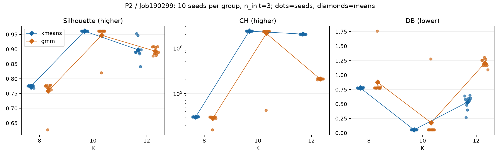
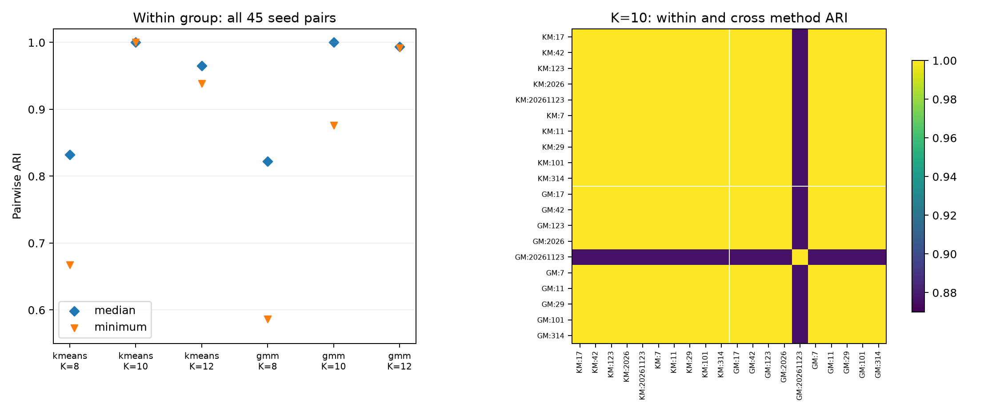

# P2 结果：K=10 的稳定性与 KMeans/GMM 选择

2026-11-23，T0017，codex。正式来源为 Slurm **Job190299**，目录 `code/q2_clustering/outputs_T0016_20261123_224500_190299/`。结果已取回并核验，尚待人工验收。

本次提供了比原两种子实验更充分的选择理由：**在预定十种子、三重启预算及课程内部评价指标下，优先选择 KMeans、K=10。** KMeans 的十次候选得到相同分区；GMM 的九次接近该分区，另一次得到似然更高、但几何指标明显较差的分区。此结论限定在本数据和实现，不推断真实类别准确率，也不宣称所有设置下 KMeans 都优于 GMM。

## 1. 运行与核验

设计沿用[P2执行说明](p2_robustness.md)：两方法×K=[8,10,12]×十预定种子，每候选三重启；全56000×512原始数据、不标准化；float32、4线程；Silhouette固定3000行子集，seed=20261011；CH/DB使用全量原始特征。

环境记录：A100-SXM4-80GB、Python3.12.15、torch2.11.0+cu128、CUDA12.8、NumPy2.5.3。框架拟合与评价计时 **18.3089秒**，不含排队、完整作业启动或其后ARI分析，不能当作两方法公平效率基准。

- 60/60候选成功，三项指标全部有效；180次内部重启均有记录。
- 封存的270项文件哈希全部匹配；12份源码/配置/作业脚本快照与本地版本在统一行尾后相同。
- 本地重新生成摘要与六份CSV，与集群分析内容相同（摘要只排除机器路径字段）。
- 原框架 `check_output` 再次通过：配置、输入哈希、候选/导出来源和56000行int32标签均一致。
- 独立列联表公式复算270对组内ARI及30对同种子跨方法ARI，与sklearn最大差 `2.22e-16`。
- 原运行目录279个文件分析前后哈希不变；未拟合、未用GPU、未在CPU回放GPU质量指标。

本地分析：`code/q2_clustering/outputs_T0017_20261123_02/`，详见 `verification.json`。原始Slurm `job.log/.out/.err` 未随结果取回；运行环境与完成状态依据已封存manifest和产物记录，不声称核验了Slurm记账退出码或完整日志。

## 2. 指标和 K 的邻域选择

下表为十种子的**均值 ± 样本标准差（ddof=1）**，全部种子保留；CH按科学记数法显示。

| 方法 | K | Silhouette ↑ | CH ↑ | DB ↓ |
|---|---:|---:|---:|---:|
| KMeans | 8 | 0.773900 ± 0.003704 | 3.04448e4 ± 5.10e2 | 0.776631 ± 0.005528 |
| KMeans | 10 | **0.961279 ± 0** | **2.36723e6 ± 0.121** | **0.053881 ± 3.93e-9** |
| KMeans | 12 | 0.898114 ± 0.031775 | 2.03344e6 ± 2.12e4 | 0.533063 ± 0.121494 |
| GMM | 8 | 0.758314 ± 0.046463 | 2.83778e4 ± 4.49e3 | 0.876772 ± 0.309680 |
| GMM | 10 | 0.947145 ± 0.044695 | 2.09717e6 ± 7.22e5 | 0.176661 ± 0.387470 |
| GMM | 12 | 0.893397 ± 0.012983 | 2.09750e5 ± 6.17e3 | 1.205507 ± 0.063914 |

图中每个点为一个种子，菱形为均值；同分点横向展开，CH纵轴为对数。来源为Job190299原始 `runs.json`，未删除较差结果。Silhouette为固定子集评价，另两项为全量评价。

**KMeans：十个种子在三项指标上都单独选择K=10。** Silhouette中，K=10相对K=8的逐种子优势至少0.183065，相对K=12至少0.008527，均超过预设并列容差1e-6。K=12有种子达到0.952752，仍低于相同种子的K=10。邻域优势并非只来自跨种子均值。

**GMM：Silhouette与CH在九个种子选K=10，seed20261123选K=12；DB十个种子均选K=10。** 三种内部指标并不完全一致。按事前规定的平均Silhouette选择，两方法各自的最佳邻域K仍为10，最终框架选择KMeans K=10。

这里只检验K=8/10/12邻域；不能写成“十种子重复验证了原八个候选K”。原八K实验仍只有两个种子。

## 3. 跨种子分区稳定性

共六个方法/K组，每组有10个候选、45对ARI；下表给出各组全部45对的范围和中位数。

| 方法 | K | ARI最小值 | 中位数 | 最大值 |
|---|---:|---:|---:|---:|
| KMeans | 8 | 0.667385 | 0.832005 | 1.000000 |
| KMeans | 10 | **1.000000** | **1.000000** | **1.000000** |
| KMeans | 12 | 0.938733 | 0.964951 | 0.999471 |
| GMM | 8 | 0.586524 | 0.822220 | 1.000000 |
| GMM | 10 | 0.876196 | 1.000000 | 1.000000 |
| GMM | 12 | 0.991798 | 0.993744 | 0.999921 |

右图按预定种子顺序排列K=10的20个分区；GM:20261123对应的明显条带体现其与其余分区的差异。左图同时保留最小值和中位数，避免中位数1掩盖单个不同种子。

KMeans K=10的45对ARI全部为1，说明十个候选的分组相同，簇号可以置换；簇大小排序均为 `[5049,5458,5458,5496,5526,5567,5587,5714,5837,6308]`。这比只看相同Silhouette更强：它直接验证了全量分区一致。

GMM K=10中，其余九个种子彼此相同，对应36对ARI=1；与seed20261123的九对ARI约0.876196。因此中位数仍为1，却不能说十个种子完全一致。

GMM K=12的ARI比KMeans K=12更高，但其CH/DB较差，且有未收敛记录。**稳定不等于聚类指标更好**；本次不支持“KMeans在所有K上都更稳定”。45对ARI共享10次候选，不能当作45次独立重复；此处没有进行假设检验或把9/10当作真实成功概率估计。

## 4. GMM 的关键不同种子：训练目标与评价目标

GMM K=10、seed20261123的三个重启均被框架判定收敛：

| 重启 | 平均对数似然 ↑ | 迭代数 | 被选中 |
|---|---:|---:|---|
| 0 | 1083.010254 | 5 | 否 |
| 1 | 1083.010254 | 5 | 否 |
| 2 | **1330.575073** | 10 | 是 |

前两次的似然与其他九种子的最佳似然相同，但框架只保存所选重启的模型/标签，不能据此断言前两次的全量分区完全相同。所选重启历史记有一次似然下降，最终按非负小变化准则判收敛；不能将日志中的收敛标志等同于全局最优。

按现有“GMM选择似然最大重启”的预设规则，第2次必须被保留。它的Silhouette为 **0.819941**、CH为 **42917.45**、DB为 **1.279419**；其他九个GMM候选分别为0.961279、2325424.25、0.054132。

所以本次差异不能简单解释成“GMM卡在更差的似然局部解”或“训练没收敛”：选中的解在其自身目标上更好，却在课程关心的几何指标上更差。这提供了**目标不一致**的直接证据，但还不足以确定具体成因为过拟合、方差问题或真实类别结构；未做特征几何/密度可视化及反事实干预。

同种子KMeans与该GMM分区ARI为0.876198，最大重叠匹配簇号后有6610/56000行分组不同（11.8036%），其中369行在固定评价子集中。对齐差异不是分类错误数。

其他九种子的两方法跨方法ARI均为0.999726，仅7行分组不同，且均不在评价子集中。这解释了多数情况下相同Silhouette：固定子集上分区相同，不能据此推断全量标签完全一致。对应九种子上KMeans的CH约高1.80%、DB约低0.465%，是小幅指标优势；整体平均差距主要由那一个不同GMM种子拉大，应同时报告中位数、范围及具体种子，不能只展示均值。

在当前预算下，“KMeans更稳健、与课程几何评价更一致”已有实测依据；这比仅靠框架默认并列优先KMeans更充分。若将来改成按内部指标选择GMM重启，或增加重启数，应预先定义新协议重新比较。更多重启也不保证解决本次问题：按似然最大选择时，这个高似然解仍可能被选中。

## 5. 失败、未收敛与簇大小

| 方法 | K | 候选成功 | 内部重启失败/30 | 达迭代上限/30 | 所选重启未收敛/10 | 全种子最小–最大簇大小 |
|---|---:|---:|---:|---:|---:|---:|
| KMeans | 8 | 10/10 | 0 | 0 | 0 | 5050–11762 |
| KMeans | 10 | 10/10 | 0 | 0 | 0 | 5049–6308 |
| KMeans | 12 | 10/10 | 0 | 0 | 0 | 1–6308 |
| GMM | 8 | 10/10 | 3 | 0 | 0 | 1330–11769 |
| GMM | 10 | 10/10 | 0 | 0 | 0 | 1338–10793 |
| GMM | 12 | 10/10 | 5 | 15 | 6 | 203–6111 |

8次失败都记录为E步责任度非负/行和归一化校验未通过；剩余重启使候选仍能输出。没有在本任务放宽容差或改实现，也不能未经复算将其全部认定为单纯舍入误报。GMM K=12所选未收敛种子为17、42、20261123、7、11、29；框架允许这类有限值结果进入评价，因此“60/60成功”不代表全180重启收敛。

KMeans K=12出现单样本簇，是需要报告的现象；不能因为KMeans K=10表现稳定就省略。这也提示过多簇在本配置下会分裂小群体，但不能单凭极小簇认定真实K。

## 6. 对原正式输出和报告的建议

P2框架选出 `kmeans_k10_seed7/restart0`，原Job177703选出seed17。新种子列表包含更小的seed7，训练目标近似并列时预设规则优先较小种子；代表种子改变并不意味着质量提升。

两份导出经全量对齐 **ARI=1、差异0行**，仅标签编号不同。十二个与原实验重叠的方法/K/seed组合也全部ARI=1。可保留原正式标签，无需仅为更换代表种子替换提交文件。

| 产物 | SHA-256 |
|---|---|
| 原Job177703 `clusters.npy` | `31ada1977a80ade1af2614f781ee07fe1f6ae836bc54b952cd719d88c5b1921b` |
| P2 Job190299 `clusters.npy` | `b6a3334d81c1abab34d2331973feb904b4a60137c9c7983feca48965f0931921` |

建议报告T1使用如下结论（本任务未修改统一报告）：

> 在固定数据、三重启预算和十个预定种子下，KMeans K=10的全量分区两两ARI均为1，且每个种子在Silhouette、CH与DB上均优于K=8/12。GMM K=10在九个种子中与其近似一致，另一个种子得到更高似然但几何指标较差的分区。因此，在本实验的硬分区评价目标下，选择KMeans K=10具有更充分的稳健性依据。该结论限定于所测K邻域与配置，不代表不受任何初始化影响，也不证明真实类别准确率更高。

复现：在 `code/q2_clustering` 执行 `python analyze_p2_results.py --source outputs_T0016_20261123_224500_190299 --output outputs_T0017_<新的运行标识>`。只读原产物，生成新分析目录和两图；当前不需要重跑全量或追加GPU实验。
