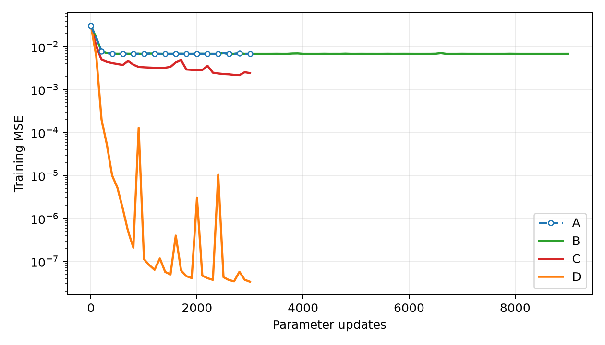
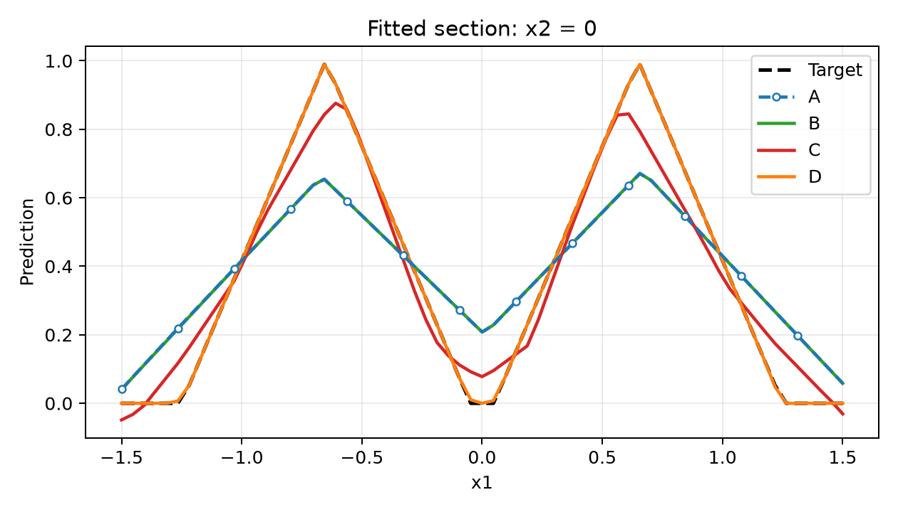
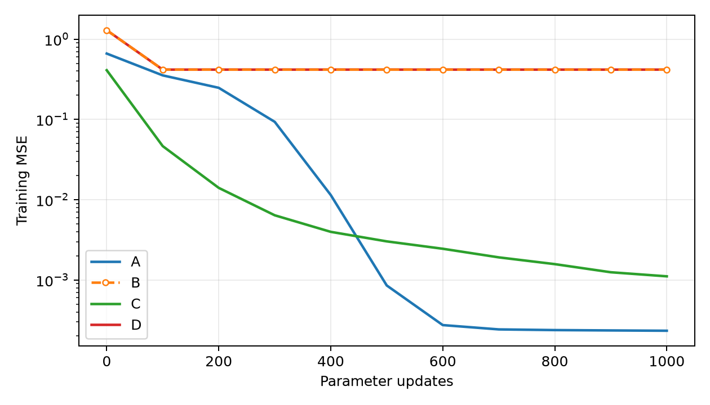
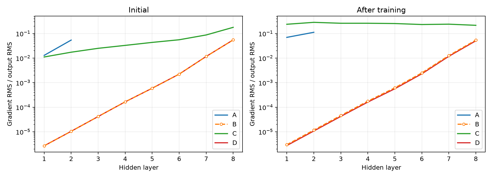

# 第一题：神经网络的拟合与梯度传播

> 源稿：2026-11-19，T0006。数据来自本次正式重跑，旧结果仅用于一致性核对。
> 提交前需本人核对数值、图表与解释，并能口头说明。

## 1. 环境与来源

| 项目 | 内容 |
|---|---|
| 设备 / 精度 | CPU，float32 |
| Python / PyTorch | 3.12.14 / 2.11.0+cpu |
| 线程 / batch | 1 / 1024 |
| 运行标识 | `outputs_T0006_20261119_01` |
| 源码 | 已入库的 `models.py`、`train.py`（commit `b7e947c`） |
| 数据与初值 | `assets/expression.npz`、`assets/initial_states.pt` |

命令（在 `code/q1_neural_network/` 下执行）：

```bash
python -m pytest -q -p no:cacheprovider
python main.py --task expression --device cpu --output outputs_T0006_20261119_01/expression
python main.py --task gradient   --device cpu --output outputs_T0006_20261119_01/gradient
```

公开测试 3 passed；两项实验分别耗时 6.71 s 和 4.05 s。八组 `summary.csv` 与既有 `outputs/` 历史结果逐字节一致，说明本次重跑复现了原结果；自此以本运行目录为正式来源。

## 2. 实验结果

### 2.1 实验 A：双峰函数拟合

| 组 | 隐藏层 | 参数量 | 更新次数 | 学习率 | 训练 MSE | 网格 MSE |
|---|---|---:|---:|---:|---:|---:|
| A 浅层基线 | [16] | 65 | 3000 | 0.01 | 6.86304e-3 | 7.02260e-3 |
| B 浅层多训练 | [16] | 65 | 9000 | 0.01 | 6.85744e-3 | 7.02569e-3 |
| C 浅层加宽 | [64] | 257 | 3000 | 0.01 | 2.42887e-3 | 2.76959e-3 |
| D 两隐藏层 | [8, 4] | 65 | 3000 | 0.01 | 3.36055e-8 | 7.62932e-7 |



图 1：四组训练 MSE 随参数更新次数变化（对数纵轴）。A、B 在约 500 步后稳定在 6.8e-3 附近，B 的 9000 步没有带来新下降；C 缓慢下降到 2.4e-3；D 在 1000 步内降到 1e-7 以下，但曲线在 800–2500 步间有数次瞬时反弹，最高约 1e-4。



图 2：x2 = 0 截面。目标在 x1 = ±0.65 处为 1、在两峰之间和支撑集外为 0。D 与目标几乎重合；C 峰值约 0.79/0.84 且两峰不对称；A 峰值约 0.65–0.67，中心 x1 = 0 处仍预测约 0.21，支撑集外仍有 0.06–0.23 的残余输出。

**观察。** 平均网格 MSE 从 A 的 7.0e-3 降到 D 的 7.6e-7，跨越约四个数量级。A、B 的终点几乎相同，说明 3000 步后加训练没有改变结果；C 加宽后误差约降为 A 的 40%；D 在参数量与 A 相同的情况下误差最低。

### 2.2 实验 B：梯度传播

| 组 | 隐藏层 | 激活 | 参数量 | 学习率 | 训练 MSE | 网格 MSE |
|---|---|---|---:|---:|---:|---:|
| A 较浅 Sigmoid | 2×32 | Sigmoid | 1185 | 0.05 | 2.33187e-4 | 2.60915e-4 |
| B 较深 Sigmoid | 8×32 | Sigmoid | 7521 | 0.05 | 4.17747e-1 | 4.29819e-1 |
| C 较深 ReLU | 8×32 | ReLU | 7521 | 0.05 | 1.11065e-3 | 1.23965e-3 |
| D 提高学习率 | 8×32 | Sigmoid | 7521 | 0.10 | 4.17747e-1 | 4.29819e-1 |



图 3：四组训练 MSE。A 从 0.66 降到 2.3e-4；C 从 0.41 降到 1.1e-3；B、D 曲线完全重合，从 1.29 降到 0.418 后从第 100 步起保持水平。



图 4：各隐藏层梯度 RMS 相对于输出端梯度 RMS 的比值 ρℓ（纵轴对数），左为初始、右为训练后。初始时 B/D 从第 1 层约 2.7e-6 逐层升到第 8 层约 5.5e-2，跨越约四个数量级；C 从 1.1e-2 只升到 1.8e-1；A 两层从 1.3e-2 升到 5.4e-2。训练后 B/D 仍保持同样斜率，C 变为约 0.22–0.29 的近似平坦分布，A 两层约 0.07–0.11。

## 3. 分析题

### 3.1 实验 A

**(a) 实际拟合差异。** D 明显优于 A：D 的网格 MSE 为 7.63e-7，A 为 7.02e-3。A 的 MSE 看似较小，但误差集中在函数最关键的部位：在左峰 x1 = −0.656、x2 = 0 处，目标 0.990，A 预测 0.654，单点误差 0.335；在 x1 = 0 处目标 0，A 预测 0.208；在支撑集外 x1 = 1.266 处目标 0，A 仍预测 0.233。D 在峰值处预测 0.990，全网格最大绝对误差仅 0.0265。MSE 对全网格 4225 个点求平均，少量峰区和边缘的大误差被大量接近零的区域稀释，因此 0.007 的平均值不足以说明拟合良好，必须结合截面和最大误差判断。

**(b) 结构与目标。** 单个峰可写成
g_c(x) = ReLU(1 − (|x1−c| + |x2|)/0.6)，
其中 |t| = ReLU(t) + ReLU(−t)。因此
|x1−c| + |x2| = ReLU(x1−c) + ReLU(c−x1) + ReLU(x2) + ReLU(−x2)。
两隐藏层网络可以按“先算距离、再截断”构造：

1. 第 1 层 8 个 ReLU 单元：对 c = ±0.65 各产生 4 个铰链项 ReLU(x1−c)、ReLU(c−x1)、ReLU(x2)、ReLU(−x2)，用偏置吸收常数；
2. 第 2 层至少 2 个 ReLU 单元：把每个峰的 4 个铰链项按 1/0.6 加权求和后，再计算 ReLU(1 − s/0.6)，得到两个截断峰（D 的 4 个单元留有余量）；
3. 线性输出：两个峰单元相加。

关键在于第二层再次使用 ReLU，对“隐藏层之和”做截断，也就是实现 ReLU(1 − Σ ReLU(·)) 的复合。单隐藏层加线性输出只能把这些 ReLU 单元线性组合，难以直接表达这种“嵌套截断”；A 虽有 16 个单元、与 D 同为 65 个参数，但缺少这一层复合，最终停在 6.9e-3 的平台。可见本题中深度带来的复合能力比单纯参数量更重要。

**(c) 改进效果与代价。** B 相对 A 把更新次数从 3000 提高到 9000，网格 MSE 从 7.02260e-3 变为 7.02569e-3，反而略高，训练 MSE 也只从 6.86304e-3 降到 6.85744e-3；A/B 都在约 500 步后进入平台，说明瓶颈是宽度 16 的表达能力，而不是训练预算。C 把宽度加到 64（参数量 257，约为 A 的 4 倍），网格 MSE 降到 2.76959e-3，约为 A 的 39%；每步计算量也随宽度增加。因此本题中“加宽”比“多训练”更有效；而 D 表明在同样 65 个参数下，增加一层复合结构还能进一步把误差降到 7.6e-7，结构和训练预算应分开评价。

### 3.2 实验 B

**(a) 训练困难的证据。** B 存在明显的梯度消失：初始时第 1 层相对梯度 2.7e-6，第 8 层 5.5e-2，相差约 2×10⁴ 倍；训练 1000 步后第 1 层仍只有 3.0e-6。作为对照，A 只有两层，初始第 1/2 层为 1.29e-2/5.41e-2，只差约 4 倍。B 的损失从 1.29 快速降到 0.418 后完全水平，接近“输出常数”的误差水平。仅凭损失下降慢不能判定梯度消失：学习率过小、Sigmoid 饱和、目标尺度或优化病态也会造成平台；必须像图 4 那样直接测量各层梯度。B 的平台伴随前层梯度比输出端小四个数量级，梯度证据才成立。

**(b) 更换激活的效果。** B 与 C 使用相同的 Linear 初值，只把 Sigmoid 换成 ReLU。C 的网格 MSE 为 1.24e-3，B 为 0.430，相差约 350 倍；初始第 1 层相对梯度从 2.7e-6 提高到 1.1e-2，约四个数量级，且层间不再呈指数衰减（1.1e-2 → 1.8e-1）。训练后 C 的各层相对梯度约为 0.22–0.29，分布接近平坦。原因是 Sigmoid 导数最大只有 0.25，8 层连乘会使前层梯度指数缩小；ReLU 对正输入导数为 1，激活路径上的梯度不会被逐层压小。需要注意 ReLU 也可能出现死亡单元，本组结果不能推广为“ReLU 一定没有梯度问题”。

**(c) 提高学习率的作用。** 本次提高学习率没有效果：B/D 的训练 MSE 分别为 0.4177474/0.4177475，网格 MSE 均为 0.429819，曲线重合，初始梯度剖面也相同。学习率直接改变的是更新幅度 Δθ = −η·g，而不是梯度 g；B、D 初始参数、数据和损失相同，所以初始梯度相同。Sigmoid 深网络的前层相对梯度只有约 10⁻⁶，学习率从 0.05 加倍到 0.1，前层更新仍然微不足道，因此损失平台不变。训练后 B/D 的梯度只在第 4 位有效数字上出现差别（例如第 1 层 2.99e-6 与 2.76e-6），也是轨迹差异造成的结果。

## 4. 与历史结果的一致性

本次重跑的两份 `summary.csv` 与既有 `outputs/` 完全一致（八组训练/网格 MSE 逐字节相同），说明此前保存的结果与当前源码、初值和命令设置相容。历史目录不再作为正式引用，报告数值统一取自本运行目录。

## 5. 局限

- 每组只有一次确定性运行：数据与初值固定、无随机采样，因此没有种子方差可报告。
- 网格 MSE 在 65×65 网格上计算；D 在训练曲线中出现的瞬时反弹（约 1e-4）说明 Adam 轨迹并非单调，但最终误差很小。
- 本分析只依据第一题的八组结果，不涉及 Q2；提交前需本人核对所有数值并用自己的语言改写。
