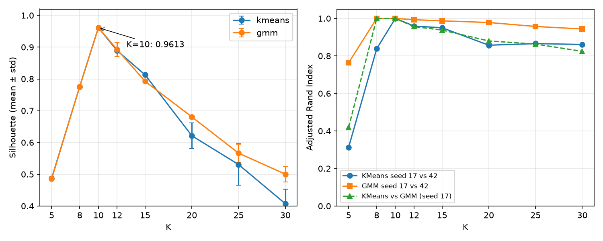
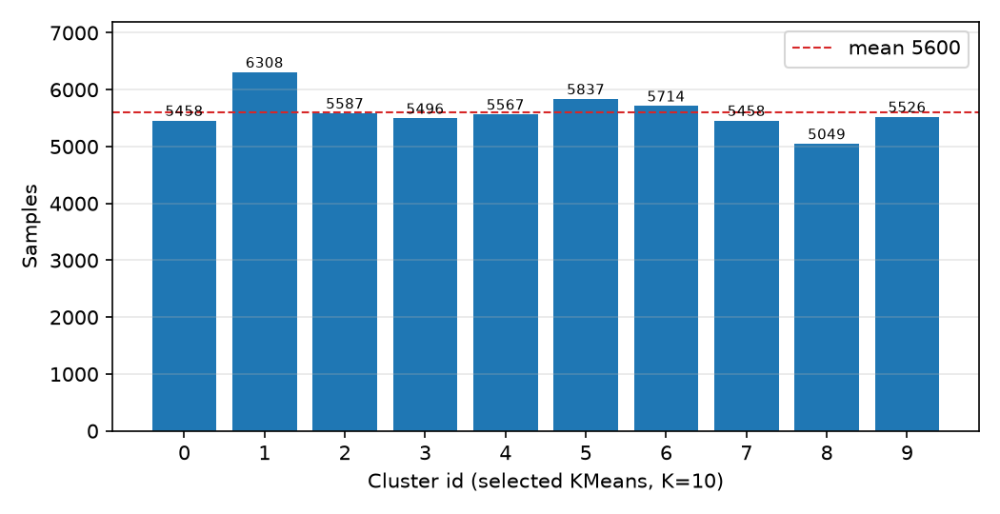

# 第二题：无监督聚类

> 源稿：2026-11-19，T0009。数据为集群 Job 177703 的正式输出，已在本地通过 `check-output`。
> 提交前需本人核对数值与解释，并能说明方法、指标和选择规则。

## 1. 环境与运行记录

| 项目 | 内容 |
|---|---|
| 作业 / 输出目录 | Job 177703；`outputs_eval_T0008_20261119_223025_177703` |
| 设备 / 精度 | CUDA，NVIDIA A100-SXM4-80GB，float32 |
| Python / PyTorch | 3.12.15 / 2.11.0+cu128（CUDA 12.8） |
| 依赖 | numpy 2.5.3、scipy 1.18.1、sklearn 1.9.1 |
| 数据 | `features.npz`，56000×512，行序不变，全部参与拟合 |
| 配置 | K=[5,8,10,12,15,20,25,30]，seeds=[17,42]，n_init=3 |
| 迭代 / 正则 | KMeans 200/1e-4；GMM 100/1e-4，reg_covar=1e-4 |
| 预处理 | 未标准化；评价在原始空间 |
| Silhouette | 无放回 3000 行，seed=20261011；CH/DB 用全量 |
| 候选 / 重启 | 32 个候选，96 次重启，全部成功 |
| 耗时 | fit 9.52 s，evaluate 2.37 s |
| 输出核验 | `check-output` 返回 `passed: true` |

命令：

```bash
python extras.py run --stage fit --device cuda --config config.json --output outputs_fit_T0008_<stamp>_<jobid>
python extras.py evaluate --device cuda --experiment outputs_fit_T0008_<stamp>_<jobid> --output outputs_eval_T0008_<stamp>_<jobid>
python extras.py check-output --output outputs_eval_T0008_<stamp>_<jobid>
```

## 2. 结果

### 2.1 方法 × K 汇总

均值与标准差来自两个种子；ARI 为 seed 17 与 seed 42 的分区一致性；最小簇取两个种子中较小值。

| 方法 | K | Silhouette 均值±std | CH 均值 | DB 均值 | 实际簇数 | 最小簇 | ARI(17,42) |
|---|---:|---:|---:|---:|---:|---:|---:|
| KMeans | 5 | 0.487472 ± 0.000474 | 12,307 | 1.3702 | 5/5 | 5,588 | 0.3128 |
| KMeans | 8 | 0.775753 ± 0.000144 | 30,689 | 0.7753 | 8/8 | 5,458 | 0.8380 |
| **KMeans** | **10** | **0.961279 ± 0.000000** | **2,367,230** | **0.0539** | **10/10** | **5,049** | **1.0000** |
| KMeans | 12 | 0.889158 ± 0.000638 | 2,029,552 | 0.6104 | 12/12 | 26 | 0.9593 |
| KMeans | 15 | 0.812752 ± 0.000706 | 1,663,810 | 1.0163 | 15/15 | 9 | 0.9501 |
| KMeans | 20 | 0.621241 ± 0.028792 | 1,335,348 | 1.2572 | 20/20 | 1 | 0.8571 |
| KMeans | 25 | 0.530525 ± 0.046066 | 1,114,263 | 1.4185 | 25/25 | 1 | 0.8659 |
| KMeans | 30 | 0.407425 ± 0.032428 | 974,904 | 101.29 | 30/30 | 1 | 0.8611 |
| GMM | 5 | 0.485256 ± 0.000297 | 12,041 | 1.3916 | 5/5 | 10,502 | 0.7634 |
| GMM | 8 | 0.775897 ± 0.000000 | 30,487 | 0.7790 | 8/8 | 5,455 | 0.9999 |
| **GMM** | **10** | **0.961279 ± 0.000000** | **2,325,424** | **0.0541** | **10/10** | **5,046** | **1.0000** |
| GMM | 12 | 0.892701 ± 0.015710 | 208,073 | 1.2550 | 12/12 | 369 | 0.9930 |
| GMM | 15 | 0.792460 ± 0.002841 | 222,298 | 1.9636 | 15/15 | 141 | 0.9870 |
| GMM | 20 | 0.680620 ± 0.003411 | 251,733 | 2.3216 | 20/20 | 80 | 0.9782 |
| GMM | 25 | 0.566394 ± 0.020284 | 274,589 | 2.3740 | 25/25 | 3 | 0.9571 |
| GMM | 30 | 0.500397 ± 0.017837 | 364,085 | 164.10 | 30/30 | 1 | 0.9437 |



图 1：左为两种方法的 Silhouette 均值（误差棒为两 seed 标准差），右为分区稳定性。K=10 时两种方法的 Silhouette 都是 0.961279；KMeans 与 GMM 在 K=10 的分区 ARI 为 0.9997。

### 2.2 K=10 明细

| 方法 | K | seed | Silhouette | CH | DB | 训练目标 | 簇大小（最小/最大） | 耗时(s) |
|---|---:|---:|---:|---:|---:|---:|---:|---:|
| KMeans | 10 | 17 | 0.961279 | 2,367,230 | 0.053881 | 惯性 74,944.86 | 5,049 / 6,308 | 0.037 |
| KMeans | 10 | 42 | 0.961279 | 2,367,230 | 0.053881 | 惯性 74,944.86 | 5,049 / 6,308 | 0.036 |
| GMM | 10 | 17 | 0.961279 | 2,325,424 | 0.054132 | 平均对数似然 1,083.01 | 5,046 / 6,309 | 0.052 |
| GMM | 10 | 42 | 0.961279 | 2,325,424 | 0.054132 | 平均对数似然 1,083.01 | 5,046 / 6,309 | 0.051 |



图 2：最终选中方案（KMeans, K=10）的簇大小，范围为 5,049–6,308，均值 5,600；没有极小簇。

**观察。** 所有 32 个候选成功、16 个方法×K 组全部可参与选择。Silhouette 在 K=10 达到唯一高峰，K=12 起下降；K>10 时 KMeans 出现 26、9、1 等极小簇，GMM 最小簇也降到 369、141、80。K=5 时 KMeans 两个种子的分区 ARI 只有 0.31，K=8 为 0.84；K=10 时两种方法的跨种子 ARI 都是 1.0。

## 3. 最终选择

框架按主指标 Silhouette 的跨种子均值选组：K=10 的 KMeans 与 GMM 均值相同（0.961279），差值在 1e-6 内，按规则优先较小 K、再优先 KMeans；组内两个种子目标值相同，按 1e-7 相对容差取较小 seed。最终：

```text
method = kmeans, K = 10, run_key = kmeans_k10_seed17, restart = 0
```

最终 `clusters.npy` 为 (56000,) int32，10 个簇，大小见上；文件 SHA-256 为 `31ada1977a80ade1af2614f781ee07fe1f6ae836bc54b952cd719d88c5b1921b`，与 `export_manifest.json` 及选中候选的标签文件一致。

## 4. T1：为什么选择这个聚类方案

最终选择 KMeans、K=10。依据有三条相互独立的证据：

1. **主指标。** K=10 的 Silhouette 为 0.961279，明显高于 K=8 的 0.776 和 K=12 的 0.889；K>12 继续下降。K=5/8 时欠分割，K≥12 时过度拆分。
2. **稳定性。** K=10 的 KMeans 与 GMM 跨种子 ARI 都是 1.0，KMeans 两个种子得到完全相同指标；两方法在 K=10 的分区 ARI 为 0.9997，说明结构不依赖初始化或具体算法。
3. **簇结构。** K=10 的 10 个簇大小在 5,049–6,308 之间，接近均衡；K=12 起出现 26、9、1 等极小簇，说明多出的中心主要是在拆分已有的簇。CH 和 DB 在 K=10 也最优（CH 最大、DB 最小）。

与其他方案比较：GMM 在 K=10 的 Silhouette 与 KMeans 相同，CH 略低（2.325M 对 2.367M），DB 略高（0.0541 对 0.0539），簇大小几乎一致；按并列规则选 KMeans。与 K=12 相比，KMeans 的 Silhouette 低约 0.072，且出现 26 个样本的小簇；与 K=8 相比，K=10 的 Silhouette 高约 0.185，簇结构更符合“每个簇规模相近”的形态。

边界：以上是**无监督证据**，K=10 是数据支持的最优候选，不等于已知真实类别数；隐藏标签 ACC 本地无法计算，99.5% 门槛无法验证。Silhouette 只在固定的 3000 行子集上计算，CH/DB 用全量原始空间；结论依赖未标准化、无放回抽样和这一对种子。

## 5. T2：为什么会出现这个实验现象

**现象。** 在 K≥12 时，两种方法的几何指标明显分化，但 Silhouette 仍然接近：

| K | Silhouette（KMeans / GMM） | CH（KMeans / GMM） | DB（KMeans / GMM） | 最小簇（KMeans / GMM） |
|---:|---:|---:|---:|---:|
| 12 | 0.889 / 0.893 | 2.03M / 0.208M | 0.610 / 1.255 | 26 / 369 |
| 15 | 0.813 / 0.792 | 1.66M / 0.222M | 1.016 / 1.964 | 9 / 141 |
| 20 | 0.621 / 0.681 | 1.34M / 0.252M | 1.257 / 2.322 | 1 / 80 |

同时，GMM 的平均对数似然随 K 单调上升（K=10 约 1083，K=12 约 1504，K=30 约 1563），但它的硬分区在 CH/DB 上明显更差；KMeans 的惯性则随 K 单调下降（74,945 → 71,976 → 70,226），这是增加中心数的必然结果。

**原因。** 两种方法优化的是不同目标：

- KMeans 最小化簇内平方距离，硬分区天然追求“欧氏空间内紧密、近似球形”的簇，因此 CH（簇间/簇内离散度比）很高、DB（簇内平均距离/中心距离）很低。
- GMM 最大化观测数据的对数似然，允许每个分量有独立的对角方差和软责任度；多出的分量可以用来解释局部方差或拉长成分，即使硬分区在欧氏几何上并不紧凑，似然仍会上升。因此 CH/DB 对 GMM 的硬分区惩罚更重。
- 在 K=10 时，数据结构清晰、簇近似各向同性，两种目标导出的硬分区几乎相同（ARI 0.9997），所以指标一致；K 增大后，GMM 更容易用额外分量做“方差不均”的解释，而 KMeans 只能用新增中心切割几何区域，二者分化。

**适用范围与局限。** 该解释针对本题的 512 维原始特征、未标准化空间和一对固定种子；KMeans 与 GMM 的训练目标（惯性 vs 对数似然）不可直接比较大小。CH/DB 偏好凸、紧致的簇，不能说明 GMM 的分区“更错”；同样，GMM 似然更高也不代表硬分区更接近隐藏类别。要判断哪个分区更可信，只能依赖无监督指标的一致性、跨种子稳定性和簇结构，而这些证据在 K=10 上恰好一致。Silhouette 使用固定 3000 行子集，CH/DB 使用全量；小簇可能在该子集中缺席，指标不应跨口径混写。

## 6. 核验与复现

- `check-output` 本地返回 `passed: true`：56000 行、int32、10 个非空簇，assigned=56000。
- `manifest.json`：completed，32/32 候选成功，16 组全部 eligible，`selection_status=selected`。
- 最终标签哈希与 `export_manifest.json`、选中候选的 `candidate/clusters.npy` 一致。
- 完整输出、模型和候选归档保留在 `code/q2_clustering/outputs_eval_T0008_20261119_223025_177703/`（本地，未入库）。

## 7. 局限

- 没有真实标签，无法计算 ACC；K=10 是无监督证据下的选择，不保证 performance 满分。
- K=10 的优势主要来自 Silhouette、CH/DB 和跨种子稳定性；三者都依赖当前特征空间和评价口径。
- 只使用两个种子；虽然 K=10 的 ARI 为 1.0，但不能据此给出置信区间。
- 未做标准化、PCA、其他聚类方法的正式对比；这些只能作为后续可选探索，不替代 KMeans/GMM 两条必做流程。
