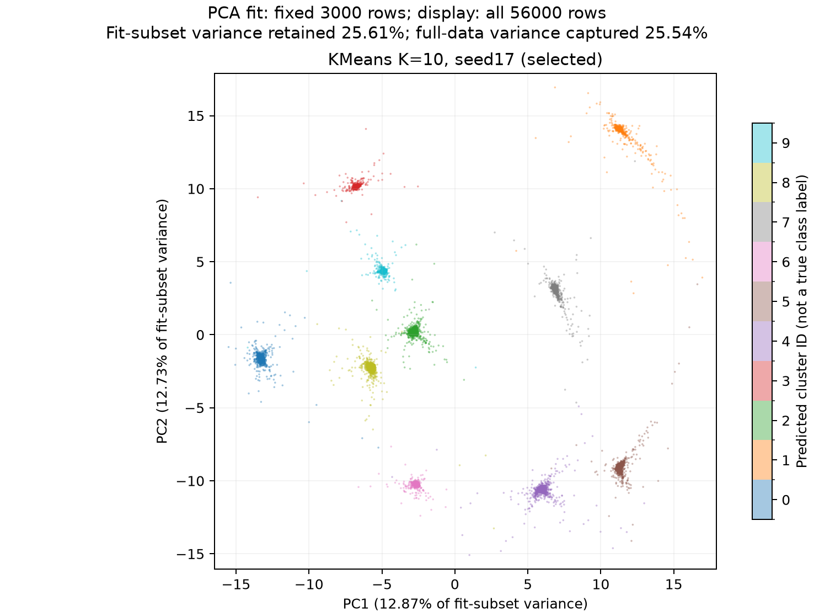
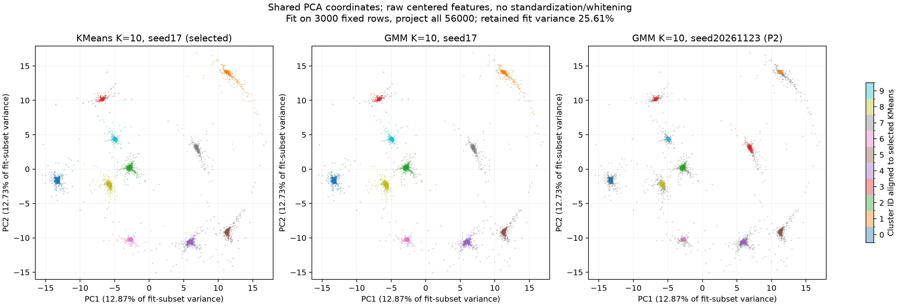

# Q2：已有聚类标签的二维 PCA 可视化

2026-11-24，T0020，codex。根据讲义附录A.4末尾（第11页）“二维PCA可以辅助展示，但需报告保留的方差比例；二维图不能代替原聚类空间的评价”制作。仅对已冻结的特征/标签做CPU轻量分析，没有重跑聚类或变更正式导出，待人工验收。

## 1. PCA与绘图口径

| 项目 | 实际使用 |
|---|---|
| 原始特征 | 原56000×512 float32数据，行序不变 |
| PCA拟合范围 | 固定3000行评价子集，与轮廓系数相同；silhouette_seed=20261011，无放回 |
| 投影/显示范围 | 全部56000行；每个点一行，未按簇筛选或重新抽取展示点 |
| 处理 | 按拟合子集均值中心化，不按维度标准化、不白化；代数计算float64 |
| 计算 | CPU，矩阵计算限制4线程；只在3000行上建立PCA基底，不在本地拟合全量PCA |
| 比较坐标系 | 三种标签共用同一基底、坐标、显示边界、色表和绘图顺序 |
| 簇号对齐 | GMM簇号按全量最大重叠匹配到KMeans；只影响展示颜色，不修改标签文件 |
| 随机顺序 | draw_order_seed=20261124，仅改变点的覆盖顺序，不改变坐标或标签 |
| 标签用途 | 聚类标签仅用于着色；没有用标签建立PCA基底，没有真实类别标签 |

本地计算是固定3000行上的PCA及已有全量数据的线性投影，不是新的全量聚类/多种子训练。此口径在图标题、坐标轴和摘要中明确记录，避免将子集PCA写成完整56000行拟合的PCA。

设子集中心化矩阵为 (X_S-\mathbf1\mu_S^T\)，对其512×512协方差矩阵取最大两个特征值对应的正交向量 (V\)。全部样本坐标为

\[
Z=(X-\mathbf1\mu_S^T)V.
\]

PCA拟合方差比例为两个特征值各除以子集协方差迹；另计算这两个方向对全量方差的捕获比例 (\mathrm{tr}(\mathrm{Cov}(Z))/\mathrm{tr}(\mathrm{Cov}(X))\)。后一比例针对这组子集拟合方向，不是全量PCA的最优两维解释率。

## 2. 方差比例与正式结果图

| 口径 | PC1 | PC2 | 合计 |
|---|---:|---:|---:|
| PCA拟合子集的解释方差 | 12.8748% | 12.7339% | **25.6087%** |
| 同一方向对全量方差的捕获比例 | 12.5513% | 12.9856% | **25.5369%** |

PC顺序按拟合子集的特征值排序；全量中的PC2方差略高于PC1不矛盾，因为没有对全量重新拟合或重排方向。全量仍有约74.46%的方差没有显示。



图1：原正式输出Job177703，KMeans K=10、seed17。显示全部56000行，颜色为预测簇编号0…9，不是真实类别。轴比例一致，PCA正交投影未另行拉伸；坐标轴比例为拟合子集的解释方差，标题另报告全量捕获比例。

可见多个较紧密的点团，主要点团之间在这个投影上有一定分离，也有离散点。该图提供几何直观，但不能由图上点团数量断言真实类别数，也不能把二维视觉分离当作隐藏标签准确率证明。

## 3. KMeans与GMM的同坐标比较



图2从左至右：原正式KMeans K10 seed17、原Job177703的GMM K10 seed17、P2 Job190299的GMM K10 seed20261123。各面板的点坐标完全相同，仅着色分区不同；GMM颜色经簇号匹配后与KMeans对应。

- 常规GMM与KMeans的图面几乎相同。全量分区对齐后仅7行不同，ARI=0.999726；不能依靠散点图辨别或忽略这些差异。
- P2的GMM种子20261123显示不同的颜色分配，同一种颜色出现在多个点团及散点中。全量分区对齐有6610行不同，ARI=0.876198，与[P2数值分析](p2_robustness_results.md)一致。
- 这组图不提供真实标签，也不能以投影中的重叠/分离单独判定谁正确。KMeans/GMM选择仍使用原512维空间的Silhouette、CH、DB及初始化稳定性证据；本任务未重算二维聚类指标。

## 4. 实际验证、来源与复现

脚本：[visualize_pca.py](../../code/q2_clustering/visualize_pca.py)。在 `code/q2_clustering` 执行：

```powershell
python visualize_pca.py --output outputs_T0020_20261124_01
```

本地Python3.12.14、NumPy2.5.3、CPU；实际运行退出0。自检包括：已知协方差toy的80%/20%解释率及重构、输入不变；PCA分量正交、协方差特征方程；子集坐标等于全量投影对应行、子集坐标方差等于两个特征值；方差比例有限且合法；原数据/索引/标签/元数据共10个输入文件哈希前后不变。两图已实际查看，图例、轴、方差比例、同坐标和着色口径已核对。

正式输入特征SHA-256：`a07578f6e1ab9d17667b987b25b1b9bc1f06a5f1f678a127e31dc78bc5ff0b38`。抽样索引SHA-256：`70d72e904d21c308ec6d82b35d9dbbfe4b79a16c2d317305205726bb0ed5b60a`；原正式标签SHA-256：`31ada1977a80ade1af2614f781ee07fe1f6ae836bc54b952cd719d88c5b1921b`。

原始分析产物在 `code/q2_clustering/outputs_T0020_20261124_01/`（忽略、本地保留）：`embedding.npy`、`fit_indices.npy`、`pca_basis.npz`、`summary.json`、两图及 `artifact_hashes.json`。摘要记录全部输入路径/哈希、脚本哈希、标签来源/匹配与方差比例；精选图直接复制到本目录figures，未改数据。

使用新输出目录可复现；PCA特征向量符号已固定，但不同数值库可能有微小舍入，若有相近/重复特征值，基底方向也可能变化。当前没有评估不同PCA子集的投影敏感性；二维图及其方差比例限定于已记录子集。没有修改统一report.md/PDF，未将本分析视为新的聚类实验。
