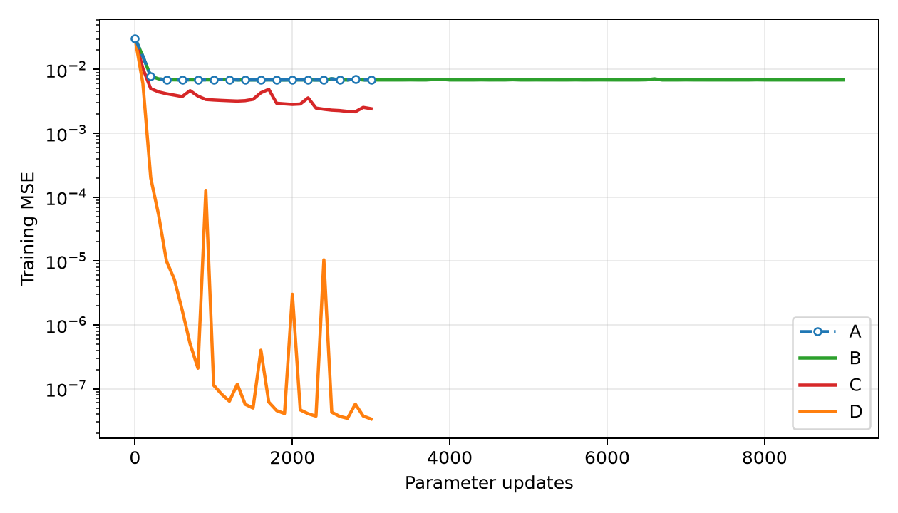
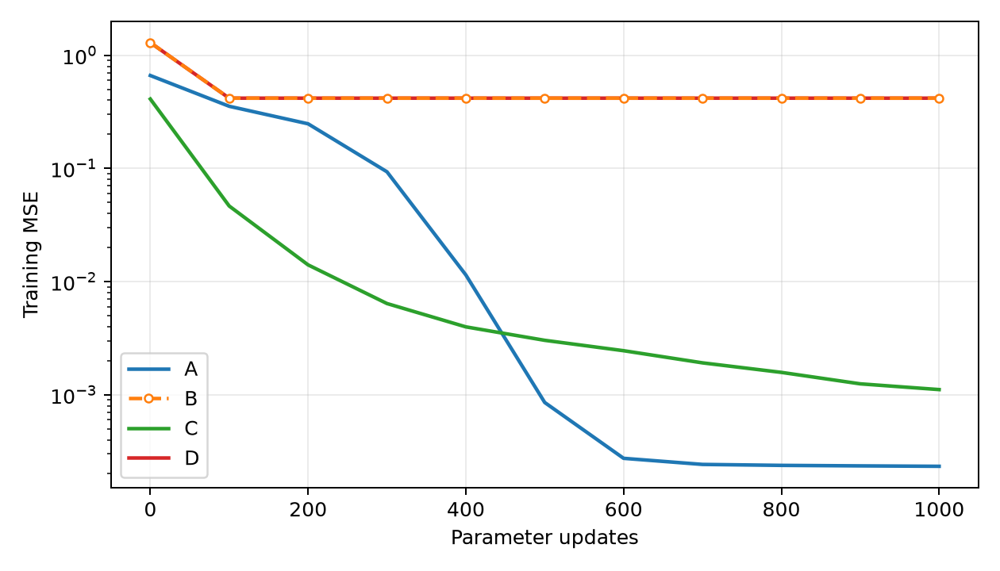
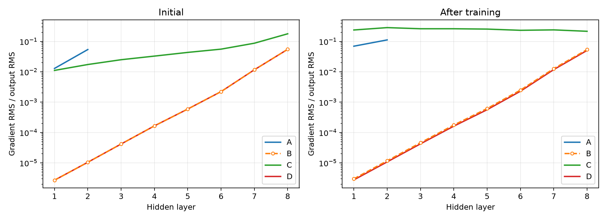
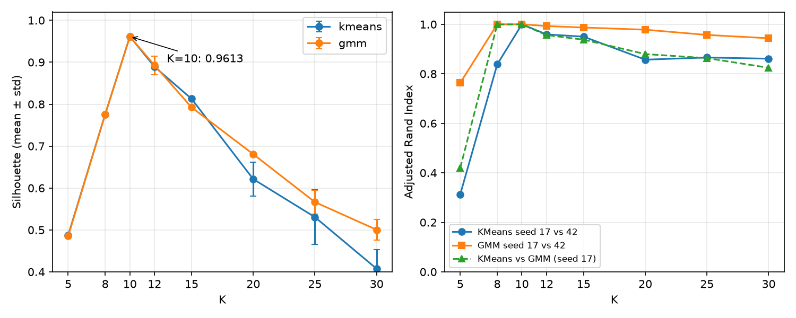
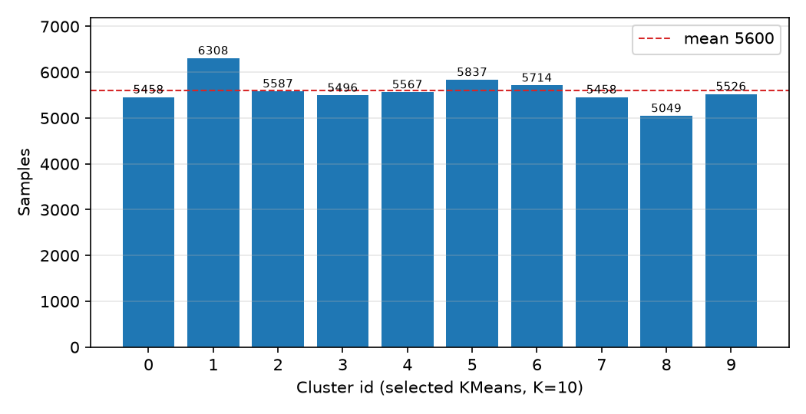

# 实验二：神经网络与无监督聚类

> 课程：人工智能与机器学习基础 ｜ 2026 年秋季学期
>
> 姓名：____________ ｜ 学号：____________ ｜ 日期：2026-11-23
>
> 初版说明：本稿由两题源稿合并，数值与解释需本人核对后定稿。

## 0 环境与运行记录

两题都在 ai26 环境中完成；第一题在本机 CPU 上运行，第二题的全量拟合与评价提交到本科生算力平台的 Slurm 作业，在单张 A100 上执行。表 0 汇总实际使用的环境与来源。

表 0：运行环境与数据来源

| 项目 | 第一题 | 第二题 |
|---|---|---|
| 运行位置 | 本机 Windows | Slurm 作业 177703 |
| 设备 | CPU | NVIDIA A100-SXM4-80GB |
| Python | 3.12.14 | 3.12.15 |
| PyTorch | 2.11.0+cpu | 2.11.0+cu128（CUDA 12.8） |
| 主要依赖 | — | NumPy 2.5.3、SciPy 1.18.1、scikit-learn 1.9.1（仅用于独立核验与分析） |
| 精度 / 线程 | float32 / 1 | float32 / 4 |
| 数据与初值 | `expression.npz`：`a84cc2c7…`；`gradient.npz`：`b3b3d273…`；`initial_states.pt`：`00eb331e…` | `features.npz`，56000 行 512 维，SHA-256 `a07578f6…` |
| 正式输出 | `outputs_T0006_20261119_01/` | `outputs_eval_T0008_20261119_223025_177703/` |

第一题的运行命令（在 `code/q1_neural_network/` 下执行）：

```bash
python -m pytest -q
python main.py --task expression --device cpu \
  --output outputs_T0006_20261119_01/expression
python main.py --task gradient --device cpu \
  --output outputs_T0006_20261119_01/gradient
```

公开测试 3 项通过；两项实验分别耗时 6.71 s 与 4.05 s。八组结果与历史 `outputs/` 中的 `summary.csv` 逐字节一致。

第二题的正式流程在作业内依次执行 `fit`、`evaluate` 和 `check-output`：32 个候选、96 次重启全部成功，`manifest.json` 状态为 `completed`，`check-output` 返回 `passed: true`；拟合与评价分别耗时 9.52 s 与 2.37 s。表 3 给出完整配置。

## 1 第一题：神经网络的拟合与梯度传播

### 1.1 实验设置与实现

MLP 由若干带偏置的线性层串联而成，隐藏层后接 ReLU 或 Sigmoid，最后经线性层输出一维预测；训练循环依次执行梯度清零、前向计算、平均 MSE、反向传播和参数更新。两项实验都使用固定的 1024 个训练点，batch 为 1024；实验 A 使用 Adam、学习率固定为 0.01，实验 B 使用 SGD。

### 1.2 实验 A：双峰函数拟合的结果

实验 A 在 `[-1.5, 1.5]` 的二维区域上拟合无噪声双峰函数，四组设置与结果如表 1。

表 1：实验 A 设置与结果（Adam，学习率 0.01，batch 1024）

| 组 | 隐藏层 | 参数量 | 更新次数 | 训练 MSE | 网格 MSE |
|---|---|---:|---:|---:|---:|
| A 浅层基线 | [16] | 65 | 3000 | 0.006863 | 0.007023 |
| B 浅层多训练 | [16] | 65 | 9000 | 0.006857 | 0.007026 |
| C 浅层加宽 | [64] | 257 | 3000 | 0.002429 | 0.002770 |
| D 两隐藏层 | [8, 4] | 65 | 3000 | 0.0000000336 | 0.000000763 |




**观察。** 平均网格 MSE 从 A 的 0.007023 降到 D 的 0.000000763，跨越约四个数量级。A、B 的终点几乎相同，B 的 9000 步没有带来新的下降；C 加宽后误差约为 A 的 39%；D 在参数量与 A 相同的情况下误差最低。D 的训练曲线在 800–2500 步之间出现数次瞬时反弹，最高约 0.0001，但最终误差仍很小。截面图上，D 与目标几乎重合；C 的两个峰高约为 0.794 与 0.843，且略不对称；A 的峰值约为 0.654–0.670，在中心 `x1 = 0` 处仍预测约 0.208，在支撑集外也保留 0.06–0.23 的残余输出。

### 1.3 实验 A 的分析

**(a) 实际拟合差异。** D 的网格 MSE 为 0.000000763，A 为 0.007023；D 在峰值处预测 0.990，全网格最大绝对误差仅 0.0265。A 的误差集中在函数最关键的部位：左峰 `x1 = -0.656` 处目标为 0.990、A 预测 0.654，单点误差约 0.335；中心 `x1 = 0` 处目标为 0、A 预测 0.208；支撑集外 `x1 = 1.266` 处目标为 0、A 仍预测 0.233。

因此，MSE 的绝对数值较小不足以说明拟合良好。网格 MSE 对 65 行 65 列共 4225 个点求平均，大量接近零的区域会稀释少量峰区和边缘的大误差；必须结合截面图、最大绝对误差和关键位置的单点误差一起判断。D 在这几项上都明显更好。

**(b) 结构与目标。** 记 `r(t) = ReLU(t)`，有 `|t| = r(t) + r(-t)`。对单个峰 c 取 -0.65 或 0.65，目标可写成

```text
|x1 - c| + |x2| = r(x1 - c) + r(c - x1) + r(x2) + r(-x2)
g_c(x1, x2) = r(1 - (|x1 - c| + |x2|) / 0.6)
```

两隐藏层网络可以按“先算距离、再截断”构造：

1. 第 1 层用 8 个 ReLU 单元，对两个峰各产生 4 个铰链项 `r(x1-c)`、`r(c-x1)`、`r(x2)`、`r(-x2)`，偏置吸收常数；
2. 第 2 层至少用 2 个 ReLU 单元，把每个峰的 4 个铰链项按 `1/0.6` 加权求和，再计算 `r(1 - s/0.6)`，得到两个截断峰；D 实际用了 4 个单元，留有余量；
3. 线性输出把两个峰单元相加。

关键在于第二层再次使用 ReLU，对“隐藏层之和”做截断，形成嵌套的 $r(1-\sum r(\cdot))$。单隐藏层加线性输出只能把 ReLU 单元线性组合，难以直接表达这种“嵌套截断”。因此 D 虽然与 A 同为 65 个参数，却能表示目标函数的结构；本题中深度的复合能力比单纯的参数量更重要。

**(c) 改进效果与代价。** B 相对 A 把更新次数从 3000 提高到 9000，网格 MSE 从 0.0070226 变为 0.0070257，反而略高；训练 MSE 也只从 0.006863 降到 0.006857。A、B 都在约 500 步后进入平台，瓶颈是宽度 16 的表达能力，而不是训练预算。

C 把宽度从 16 增加到 64，参数量从 65 增加到 257（约 4 倍），网格 MSE 降到 0.002770，约为 A 的 39%；代价是每步计算量随宽度增加。D 表明在同样 65 个参数下，增加一层复合还能把网格 MSE 进一步降到 0.000000763。由此可见，本题中加宽比多训练更有效；结构和训练预算应分开评价，不能只比较参数量或训练步数。

### 1.4 实验 B：梯度传播的结果

实验 B 在 `[-1, 1]` 的二维区域上拟合线性函数 `y = x1 + 0.5x2`，四组设置与结果如表 2。

表 2：实验 B 设置与结果（SGD，batch 1024，1000 次更新，每层 32 个单元）

| 组 | 隐藏层 | 激活 | 学习率 | 参数量 | 训练 MSE | 网格 MSE |
|---|---|---|---:|---:|---:|---:|
| A 较浅 Sigmoid | 2 层 | Sigmoid | 0.05 | 1185 | 0.0002332 | 0.0002609 |
| B 较深 Sigmoid | 8 层 | Sigmoid | 0.05 | 7521 | 0.4177 | 0.4298 |
| C 较深 ReLU | 8 层 | ReLU | 0.05 | 7521 | 0.001111 | 0.001240 |
| D 提高学习率 | 8 层 | Sigmoid | 0.10 | 7521 | 0.4177 | 0.4298 |





**观察。** A 的训练 MSE 从 0.6623 降到 0.0002332；C 从 0.4106 降到 0.001111；B、D 的曲线完全重合，从 1.294 降到 0.417747 后从第 100 步起保持水平。初始时 B/D 第 1 层的 ρ 约为 0.0000027，第 8 层约为 0.055，跨越约四个数量级；C 从 0.0111 只升到 0.179；A 的两层从 0.0129 升到 0.0541，只差约 4 倍。训练后 B/D 仍保持相同的层间斜率，C 的各层 ρ 约为 0.22–0.29，接近平坦。

### 1.5 实验 B 的分析

**(a) 训练困难的证据。** B 存在明显的梯度消失。初始时第 1 层相对梯度约为 0.0000027，第 8 层约为 0.055，相差约两万倍；训练 1000 步后第 1 层仍只有约 0.0000030。作为对照，A 只有两层，初始的第 1/2 层为 0.0129/0.0541，只差约 4 倍。B 的损失从 1.294 快速降到 0.417747 后完全水平，接近“输出常数”的误差水平。

仅凭损失下降缓慢不能判定梯度消失：学习率过小、Sigmoid 饱和、目标尺度或优化病态也会造成平台。必须像图 4 那样直接测量各层梯度；B 的平台伴随前层梯度比输出端小四个数量级，梯度证据才成立。

**(b) 更换激活的效果。** B 与 C 使用相同的 Linear 初值，只把 Sigmoid 换成 ReLU。C 的网格 MSE 为 0.001240，B 为 0.4298，相差约 350 倍；初始第 1 层相对梯度从 0.0000027 提高到 0.0111，约四个数量级，且层间不再呈指数衰减（从 0.0111 升到 0.179）；训练后 C 的各层相对梯度约为 0.22–0.29，分布接近平坦。

原因是 Sigmoid 的导数最大只有 0.25，8 层连乘会使前层梯度指数缩小；ReLU 对正输入导数为 1，激活路径上的梯度不会被逐层压小。需要注意，ReLU 也可能出现死亡单元，本组结果不能推广为“ReLU 一定没有梯度问题”。

**(c) 提高学习率的作用。** 本次提高学习率没有效果：B、D 的训练 MSE 分别为 0.4177474 与 0.4177475，网格 MSE 均为 0.4298，曲线重合，初始梯度剖面也相同。学习率直接改变的是更新幅度 Δθ = -ηg，而不是梯度 g；两组初始参数、数据和损失相同，所以初始梯度相同。Sigmoid 深网络的前层相对梯度只有约百万分之一，学习率从 0.05 加倍到 0.1，前层更新仍然微不足道，因此损失平台不变。训练后 B/D 的梯度只在第 4 位有效数字上出现差别（例如第 1 层 0.00000299 与 0.00000276），这是轨迹差异造成的结果。

### 1.6 第一题小结

本题中，结构（深度带来的复合能力）比单纯参数量更重要：相同 65 个参数下，两隐藏层的 D 远好于单隐藏层的 A；在表达能力不足时，增加训练步数（B）几乎无效，而加宽（C）能降低误差。深 Sigmoid 网络的主要问题是前层梯度指数衰减，换用 ReLU 能显著改善梯度传播；只把学习率加倍不能改变前层梯度过小的事实。以上结论均来自固定数据、固定初值和一次确定性运行，不涉及随机种子方差。

\clearpage

## 2 第二题：无监督聚类

### 2.1 数据与实验设置

数据为 56000 行、512 维的 float32 匿名特征矩阵，全部样本参与拟合，不使用任何标签。拟合前不做标准化，评价在原始特征空间进行。表 3 汇总配置与口径。

表 3：第二题数据、配置与评价口径

| 项目 | 设置 |
|---|---|
| 数据 | 56000 行、512 维，float32，行序不变，全部参与 |
| 方法 | KMeans++ 初始化的 KMeans；对角协方差 GMM |
| 候选 K | 5、8、10、12、15、20、25、30 |
| 随机种子 | 17、42 |
| 初始化次数 | 每个“方法/K/seed”重启 3 次 |
| 迭代与收敛 | KMeans 最多 200 次、tol 0.0001；GMM 最多 100 次、tol 0.0001 |
| GMM 正则 | `reg_covar = 0.0001` |
| 预处理 | 不标准化；拟合与评价均为原始空间 |
| Silhouette | 无放回抽取 3000 行，抽样种子 20261011；CH、DB 使用全量 |
| 主指标与选择 | Silhouette 跨种子均值最大；0.000001 内并列取较小 K，再取 KMeans；组内按训练目标选代表运行 |
| 候选规模 | 32 个候选，96 次重启，全部成功 |

最终输出 `clusters.npy` 为 (56000,) int32，SHA-256 `31ada197…`；`check-output` 通过。

KMeans 的惯性与 GMM 的平均观测对数似然不是同一个训练目标，以下表格不比较二者的数值大小；Silhouette 只在固定的 3000 行子集上计算，CH 和 DB 使用全量样本。

### 2.2 实现与自检

需要补全的五个算法函数（KMeans++ 初始化、样本分配、中心更新、GMM E 步和 M 步）与三个评价函数（Silhouette、CH、DB）均用 PyTorch 实现，保留输入张量的 dtype 与设备，不修改输入。

补全后完成的自检包括：算法 7 项、评价 5 项；float32 与 float64 各 12 项；完整框架测试 48 项通过、49 个子测试通过；与独立实现的对拍 29 项通过。正式作业中，CUDA float32/float64 自检均通过，最终输出经 `check-output` 核验为 `passed: true`：56000 行、int32、10 个非空簇、assigned = 56000。

### 2.3 两种方法的实测比较

表 4 按“方法/K”汇总两个种子的结果。Silhouette 与 CH 越大越好，DB 越小越好；最小簇取两个种子中的较小值。

表 4：KMeans 与 GMM 在全部候选上的结果

| 方法 | K | Silhouette（均值±标准差） | CH | DB | 最小簇 | ARI(seed 17, 42) |
|---|---:|---:|---:|---:|---:|---:|
| KMeans | 5 | 0.487472 ± 0.000474 | 12,307 | 1.3702 | 5,588 | 0.3128 |
| KMeans | 8 | 0.775753 ± 0.000144 | 30,689 | 0.7753 | 5,458 | 0.8380 |
| **KMeans** | **10** | **0.961279 ± 0.000000** | **2,367,230** | **0.0539** | **5,049** | **1.0000** |
| KMeans | 12 | 0.889158 ± 0.000638 | 2,029,552 | 0.6104 | 26 | 0.9593 |
| KMeans | 15 | 0.812752 ± 0.000706 | 1,663,810 | 1.0163 | 9 | 0.9501 |
| KMeans | 20 | 0.621241 ± 0.028792 | 1,335,348 | 1.2572 | 1 | 0.8571 |
| KMeans | 25 | 0.530525 ± 0.046066 | 1,114,263 | 1.4185 | 1 | 0.8659 |
| KMeans | 30 | 0.407425 ± 0.032428 | 974,904 | 101.29 | 1 | 0.8611 |
| GMM | 5 | 0.485256 ± 0.000297 | 12,041 | 1.3916 | 10,502 | 0.7634 |
| GMM | 8 | 0.775897 ± 0.000000 | 30,487 | 0.7790 | 5,455 | 0.9999 |
| **GMM** | **10** | **0.961279 ± 0.000000** | **2,325,424** | **0.0541** | **5,046** | **1.0000** |
| GMM | 12 | 0.892701 ± 0.015710 | 208,073 | 1.2550 | 369 | 0.9930 |
| GMM | 15 | 0.792460 ± 0.002841 | 222,298 | 1.9636 | 141 | 0.9870 |
| GMM | 20 | 0.680620 ± 0.003411 | 251,733 | 2.3216 | 80 | 0.9782 |
| GMM | 25 | 0.566394 ± 0.020284 | 274,589 | 2.3740 | 3 | 0.9571 |
| GMM | 30 | 0.500397 ± 0.017837 | 364,085 | 164.10 | 1 | 0.9437 |

> 标准差为两个种子之间的样本标准差；只有两个种子，不能当作置信区间。ARI 比较的是两个预测分区，不使用真实标签。

表 5：K=10 的明细

| 方法 | seed | Silhouette | CH | DB | 训练目标 | 簇大小（最小/最大） | 耗时 (s) |
|---|---:|---:|---:|---:|---:|---:|---:|
| KMeans | 17 | 0.961279 | 2,367,230 | 0.053881 | 惯性 74,944.86 | 5,049 / 6,308 | 0.037 |
| KMeans | 42 | 0.961279 | 2,367,230 | 0.053881 | 惯性 74,944.86 | 5,049 / 6,308 | 0.036 |
| GMM | 17 | 0.961279 | 2,325,424 | 0.054132 | 对数似然 1083.01 | 5,046 / 6,309 | 0.052 |
| GMM | 42 | 0.961279 | 2,325,424 | 0.054132 | 对数似然 1083.01 | 5,046 / 6,309 | 0.051 |





**观察。** 所有 32 个候选成功，16 个“方法/K”组全部参与选择。Silhouette 在 K=10 出现唯一高峰，K=12 起下降；K 超过 10 后，KMeans 出现 26、9、1 等极小簇，GMM 的最小簇也降到 369、141、80。K=5 时 KMeans 两个种子的分区 ARI 只有 0.3128，K=8 为 0.8380；K=10 时两种方法的跨种子 ARI 都是 1.0000，KMeans 两个种子的指标完全相同。K=10 的 10 个簇大小在 5,049–6,308 之间，接近均衡。

### 2.4 T1：为什么选择这个聚类方案

最终选择 KMeans、K=10（`run_key = kmeans_k10_seed17`，restart 0）。依据有三条相互独立的证据：

1. **主指标。** K=10 的 Silhouette 为 0.961279，明显高于 K=8 的 0.775753 和 K=12 的 0.889158；K 继续增大时指标继续下降。K=5、K=8 时更像欠分割，K 不低于 12 时更像过度拆分。
2. **稳定性。** K=10 时 KMeans 与 GMM 的跨种子 ARI 都是 1.0000，KMeans 两个种子得到完全相同的指标与簇大小；两种方法在该 K 的分区 ARI 为 0.9997，说明结果不依赖初始化，也不依赖具体算法。
3. **簇结构。** K=10 的 10 个簇大小在 5,049–6,308 之间，没有极小簇；K=12 起出现 26、9、1 等极小簇，说明多出的中心主要是在拆分已有簇。CH 和 DB 也在 K=10 达到最优（CH 最大、DB 最小）。

与其他方案比较：GMM 在 K=10 的 Silhouette 与 KMeans 相同，CH 略低（2,325,424 对 2,367,230），DB 略高（0.0541 对 0.0539），簇大小几乎一致；按并列规则优先选择 KMeans。与 K=12 相比，K=10 的 Silhouette 高约 0.072，且没有 26 个样本的小簇；与 K=8 相比，K=10 的 Silhouette 高约 0.186，簇规模也更均衡。

边界：以上都是无监督证据。K=10 是当前数据与指标支持的最优候选，不等于已知的真实类别数；隐藏标签的多数票 ACC 只在教师侧计算，本地无法验证 99.5% 门槛。Silhouette 只在固定的 3000 行子集上计算，CH/DB 使用全量原始空间；结论依赖未标准化、无放回抽样和这一对种子。

### 2.5 T2：为什么会出现这个实验现象

**现象。** K 不低于 12 时，两种方法在几何指标上明显分化，但 Silhouette 仍然接近；同时，GMM 的平均对数似然随 K 单调上升，而 KMeans 的惯性随 K 单调下降（表 6）。

表 6：K 不低于 12 时两种方法的指标分化

| K | Silhouette（KMeans / GMM） | CH（KMeans / GMM） | DB（KMeans / GMM） | 最小簇（KMeans / GMM） |
|---:|---:|---:|---:|---:|
| 12 | 0.889 / 0.893 | 2,029,552 / 208,073 | 0.610 / 1.255 | 26 / 369 |
| 15 | 0.813 / 0.792 | 1,663,810 / 222,298 | 1.016 / 1.964 | 9 / 141 |
| 20 | 0.621 / 0.681 | 1,335,348 / 251,733 | 1.257 / 2.322 | 1 / 80 |

GMM 的平均对数似然（以 seed 17 为例）从 K=10 的约 1083 升到 K=12 的约 1504、K=30 的约 1563；KMeans 的惯性则从 K=10 的 74,944.86 降到 K=12 的 71,976.23、K=15 的 70,226.32。两者都在自己的训练目标上“变得更好”，但硬分区在 CH/DB 上的表现并不一致。

**原因。** 两种方法优化的是不同目标。KMeans 最小化簇内平方距离，硬分区天然追求欧氏空间中紧密、近似球形的簇，因此 CH（簇间/簇内离散度比）较高、DB（簇内平均距离/中心距离）较低。GMM 最大化观测数据的对数似然，允许每个分量有独立的对角方差和软责任度；多出的分量可以用来解释局部方差或拉长成分，即使硬分区在欧氏几何上并不紧凑，似然仍会上升，所以 CH/DB 对 GMM 硬分区的惩罚更重。

在 K=10 时，数据结构清晰、簇近似各向同性，两种目标导出的硬分区几乎相同（ARI 0.9997），三项指标因此一致；K 增大后，GMM 更容易用额外分量解释方差不均，而 KMeans 只能用新增中心切割几何区域，二者开始分化。

**适用范围与局限。** 该解释针对本题的 512 维原始特征、未标准化空间和固定的一对种子。KMeans 惯性与 GMM 对数似然不可直接比较大小；CH/DB 偏好凸、紧致的簇，不能据此说 GMM 的分区“更错”，GMM 似然更高也不代表硬分区更接近隐藏类别。要判断哪个分区更可信，只能依赖无监督指标的一致性、跨种子稳定性和簇结构；这些证据在 K=10 上恰好一致。Silhouette 使用 3000 行固定子集，CH/DB 使用全量，小簇可能在子集中缺席，指标不能跨口径混写。

### 2.6 第二题的局限

- 没有真实标签，无法计算 ACC；K=10 是无监督证据下的选择，不保证教师侧 performance 满分。
- 主指标 Silhouette 只在固定的 3000 行子集上计算，CH/DB 使用全量；三者衡量性质不同，结论依赖当前特征空间与评价口径。
- 每个“方法/K”只有两个种子；K=10 的 ARI 为 1.0000，但不能据此给出置信区间或显著性结论。
- 未做标准化、PCA 或其他聚类方法的正式对比；这些只能作为后续探索，不替代 KMeans 与 GMM 两条必做流程。

## 3 结论

第一题中，双峰函数的拟合差异主要来自网络结构而非训练预算：相同参数量下，两隐藏层通过嵌套 ReLU 截断显著降低了误差，单隐藏层加宽只能部分改善，单纯增加训练步数基本无效。梯度实验表明，深 Sigmoid 网络的前层梯度指数衰减是训练停滞的直接原因；换用 ReLU 能恢复层间梯度，单纯提高学习率不能改变梯度本身。

第二题中，在全部 56000 个样本、8 个候选 K、2 个种子和两种方法的 32 个候选中，K=10 的 KMeans 与 GMM 在 Silhouette、跨种子稳定性和簇均衡性上同时达到最优；按框架规则选择 KMeans、K=10，最终簇大小为 5,049–6,308。该结果是当前无监督证据下的最优选择，不代表已知真实类别数，也不构成对教师侧 ACC 的声明。