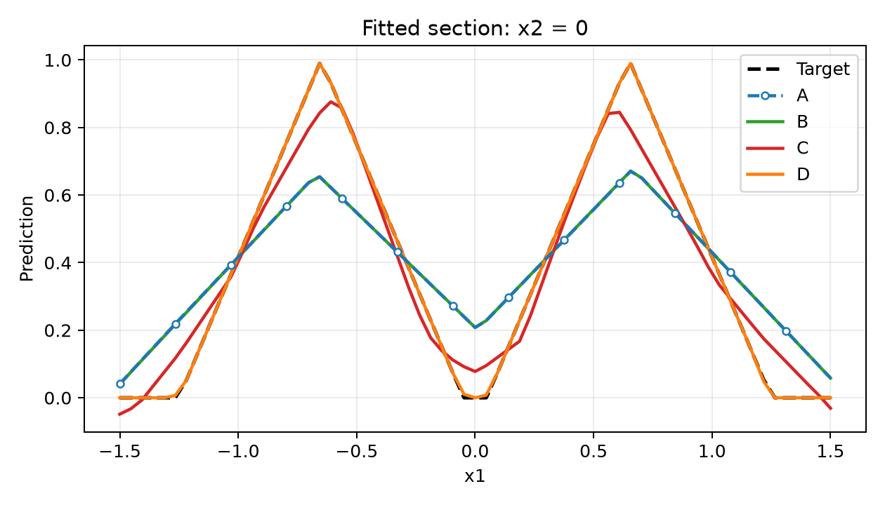

# 实验二：神经网络与无监督聚类

> 课程：人工智能与机器学习基础 ｜ 2026 年秋季学期
>
> 姓名：____________ ｜ 学号：____________ ｜ 日期：2026-11-23
>
> 初版说明：本稿由两题源稿合并，数值与解释需本人核对后定稿。

## 0 环境与设备

按照实验讲义要求，两个实验都在 ai26 环境中完成；第一题八组在本机 CPU 上运行，第二题的全量拟合与评价在本科生算力平台上用 Slurm 作业完成。表 0 汇总基线实际使用的环境与来源。

表 0：运行环境与数据来源
（需要自行重新检查一遍，删除一些多余的话）

| 项目      | 第一题                                                                                     | 第二题                                                     |
| ------- | --------------------------------------------------------------------------------------- | ------------------------------------------------------- |
| 运行位置    | 本机 Windows                                                                              | Slurm 作业 177703                                         |
| 设备      | CPU                                                                                     | NVIDIA A100-SXM4-80GB                                   |
| Python  | 3.12.14                                                                                 | 3.12.15                                                 |
| PyTorch | 2.11.0+cpu                                                                              | 2.11.0+cu128（CUDA 12.8）                                 |
| 主要依赖    | —                                                                                       | NumPy 2.5.3、SciPy 1.18.1、scikit-learn 1.9.1（仅用于独立核验与分析） |
| 精度 / 线程 | float32 / 1                                                                             | float32 / 4                                             |
| 数据与初值   | `expression.npz`：`a84cc2c7…`；`gradient.npz`：`b3b3d273…`；`initial_states.pt`：`00eb331e…` | `features.npz`，56000 行 512 维，SHA-256 `a07578f6…`        |
| 正式输出    | `outputs_T0006_20261119_01/`                                                            | `outputs_eval_T0008_20261119_223025_177703/`            |
## 1 第一题：神经网络的拟合与梯度传播

### 1.1 实验 A：双峰函数拟合的结果

实验 A 在 `[-1.5, 1.5]` 的二维区域上拟合无噪声双峰函数，四组设置与结果如表 1。

表 1：实验 A 设置与结果（Adam，学习率 0.01，batch 1024）

| 组 | 隐藏层 | 参数量 | 更新次数 | 训练 MSE | 网格 MSE |
|---|---|---:|---:|---:|---:|
| A 浅层基线 | [16] | 65 | 3000 | 0.006863 | 0.007023 |
| B 浅层多训练 | [16] | 65 | 9000 | 0.006857 | 0.007026 |
| C 浅层加宽 | [64] | 257 | 3000 | 0.002429 | 0.002770 |
| D 两隐藏层 | [8, 4] | 65 | 3000 | 0.0000000336 | 0.000000763 |




**简要观察：**
 **网格 MSE：** A作为基线，A、B 的终点值几乎相同，C 约为 A 的 39%，D的下降最为显著，与A相比跨越四个数量级。整体误差 A ≈ B > C >> D。
 **训练曲线：** A，B的曲线基本重合，在 200 后 MSE 基本稳定；C 的曲线稳步下降，但是存在少量反弹的峰值，总体小于 A 的训练MSE；D 的曲线在 800–2500 步之间出现数次瞬时反弹，最高约 0.0001，总体上显著小于前面 3 组。
 **截面图：** A，B几乎重合；D 与目标几乎重合；C 的两个峰比目标低，且略不对称，在`x1 = 0`处比目标要高；A，B 的峰值约为 0.654–0.670，相较其他组峰值最低，在中心 `x1 = 0` 处预测为0.208，与目标差异较大。

### 1.3 实验 A 的分析

**(a) 实际拟合差异：D的拟合效果更好**。 
从MSE来看，D 的网格 MSE 为 0.000000763，A 为 0.007023；
从截面图来看，D与目标函数基本重合，全网格最大绝对误差仅 0.0265，而A 的误差集中在函数最关键的部位：左峰 `x1 = -0.656` 处误差约 0.335；中心 `x1 = 0` 处目标为 0、A 预测 0.208。
**MSE 的绝对数值较小不足以说明拟合良好**。由于网格 MSE 对高达4225 个点求平均，大量接近零的点会稀释少量的峰区和边缘的大误差。例如 A 的 MSE 为10e-3量级，数值上已经很小，但是从截面图可以看出在关键的峰值和中心处与目标差距较大，拟合效果不好。
所以，判断拟合效果必须结合截面图来看，也可以参考最大绝对误差和关键位置的单点误差一起。D 在这几项上都明显更好。

**(b) 结构与目标。** 
**数学推导：** 记 `r(t) = ReLU(t)`，有 `|t| = r(t) + r(-t)`。先考虑单个峰 ，c 取 -0.65 或 0.65，目标可写成
```text
|x1 - c| + |x2| = r(x1 - c) + r(c - x1) + r(x2) + r(-x2)
g_c(x1, x2) = r(1 - (|x1 - c| + |x2|) / 0.6)
```
**与构造的对应：** 两隐藏层网络可以按如下方式构造：
1. 第 1 层用 8 个 ReLU 单元，对两个峰各产生 4 个项 `r(x1-c)`、`r(c-x1)`、`r(x2)`、`r(-x2)`，用偏置来吸收常数；
2. 第 2 层至少用 2 个 ReLU 单元：先把每个峰的 4 个项求和得到s，再利用两个 ReLU 表示 `r(1 - s/0.6)`；D 实际用了 4 个单元，留有余量；
3. 线性输出把两个峰相加。
本实验的关键在于第二层再次使用 ReLU，形成嵌套的 $r(1-\sum r(\cdot))$，而单隐藏层加线性输出只能把 ReLU 单元线性组合，难以直接表达这种嵌套。**因此双隐藏层更适合表示本题的结构。**

**(c) 改进效果与代价。** 
**B 相对 A：** 把更新次数从 3000 提高到 9000，网格 MSE 从 0.0070226 变为 0.0070257，训练 MSE 也只从 0.006863 降到 0.006857。增加的成本为更新次数+6000，而效果却几乎没有提升，说明**增加更新步数的改进效果不好，A的效果不好不是更新步数不够导致的**。
**C相对A：** 把宽度从 16 增加到 64，参数量从 65 增加到 257，网格 MSE 降到 0.002770，约为 A 的 39%，增加的成本是每步计算量随宽度增加。这说明**加宽是有一定效果的，但是会增加计算成本**。
综合来看，**加宽的改进效果更好**，（待补充原因和有关实验论证）

### 1.4 实验 B：梯度传播的结果

实验 B 在 `[-1, 1]` 的二维区域上拟合线性函数 `y = x1 + 0.5x2`，四组设置与结果如表 2。

表 2：实验 B 设置与结果（SGD，batch 1024，1000 次更新，每层 32 个单元）

| 组 | 隐藏层 | 激活 | 学习率 | 参数量 | 训练 MSE | 网格 MSE |
|---|---|---|---:|---:|---:|---:|
| A 较浅 Sigmoid | 2 层 | Sigmoid | 0.05 | 1185 | 0.0002332 | 0.0002609 |
| B 较深 Sigmoid | 8 层 | Sigmoid | 0.05 | 7521 | 0.4177 | 0.4298 |
| C 较深 ReLU | 8 层 | ReLU | 0.05 | 7521 | 0.001111 | 0.001240 |
| D 提高学习率 | 8 层 | Sigmoid | 0.10 | 7521 | 0.4177 | 0.4298 |


**观察。** 
 **训练效果：** A、C 的损失持续下降并达到较低水平，C 的最终误差高于 A；B、D 的曲线完全重合，早期下降后基本保持水平，最终误差远高于 A、C。
 **梯度层间分布：** 初始时 B/D 的梯度从输出端向前层明显衰减，A 的两层差别较小，C 的梯度分布较平缓；训练后 B/D 仍保持相似的层间衰减形态，C 的各层梯度接近平坦。

### 1.5 实验 B 的分析

**(a) 训练困难的证据。** **B 存在明显的梯度消失**。
**对于B：** 共有 8 层，初始时第 1 层相对梯度约为 0.0000027，第 8 层约为 0.055，相差约两万倍；训练 1000 步后第 1 层仍只有约 0.0000030；浅层的梯度极小，出现梯度消失。
**对于A：** 只有 2 层，初始的第 1/2 层为 0.0129/0.0541，只差约 4 倍。
**从损失来看：** B 的损失在100步后就几乎水平，而 A 的损失直到 600 步后才趋于水平；这可以说明B 存在训练困难。
**仅凭损失下降缓慢不能判定梯度消失**，例如学习率过小、Sigmoid 饱和、目标尺度或优化病态也会造成损失趋于水平。（实验补充）
必须如图 4 直接测量各层梯度，发现 B 前层梯度比输出端小四个数量级，才能说明是**梯度消失导致了训练困难**。

**(b) 更换激活的效果。**
**从梯度来看：** 训练前 C 的梯度从后向前缓慢下降，训练后梯度分布接近平坦；不再出现B中的梯度消失现象。
**从拟合效果来看：** C的网格 MSE 为 0.001240，B 为 0.4298，相差约 350 倍，效果提升显著。
**原因分析：**
Sigmoid 的导数最大为 0.25，多个局部导数与权重矩阵连乘可能削弱前层传播，导致前层梯度较小，进一步导致更新困难，拟合效果差；而ReLU 在正区间的局部导数为 1，不会带来局部缩放，整体梯度取决于权重矩阵和激活路径，不会像 Sigmoid 一样出现梯度消失，相比之下拟合效果较好。

**(c) 提高学习率的作用。** 
**本次提高学习率没有效果：** B、D 的训练 MSE 分别为 0.4177474 与 0.4177475，网格 MSE 均为 0.4298，曲线重合，初始梯度剖面也相同。（截面图没有画出来）
**学习率直接改变的是更新幅度 Δθ = -ηg，而不是梯度 g：** 由 **(a)** 的分析可知，B存在梯度消失，前层相对梯度只有约百万分之一，即使学习率从 0.05 加倍到 0.1，前层更新幅度仍然微不足道，因此提高学习率没有效果。
**梯度：** 初始阶段，由于初始参数相同，B，D梯度相同； 训练后由于学习率不同，梯度产生差异，但是由于存在梯度消失，B，D梯度的差异不大，逐层相对梯度相差约 7–9%。


### 1.6 第一题小结

双峰实验中，给定初值下，增加训练步数（B）改善很小，加宽（C）能降低误差；在相同 65 个参数下，两隐藏层的 D 远好于单隐藏层的 A，这说明合适的神经网络结构可以有效提高拟合效果；
梯度实验中，深 Sigmoid 网络前层梯度明显衰减，换用 ReLU 改善了传播与拟合，而学习率加倍不能解决训练困难。这说明激活函数对于神经网络的优化有着比较重要的作用。

\clearpage

## 2 第二题：无监督聚类

### 2.1 数据与实验设置

表 3：第二题数据、配置与评价口径

| 项目         | 设置                                                          |
| ---------- | ----------------------------------------------------------- |
| 数据         | 56000 行、512 维，float32，行序不变，全部参与                             |
| 方法         | KMeans++ 初始化的 KMeans；对角协方差 GMM                              |
| 候选 K       | 5、8、10、12、15、20、25、30                                       |
| 随机种子       | 17、42                                                       |
| 初始化次数      | 每个“方法/K/seed”重启 3 次                                         |
| 迭代与收敛      | KMeans 最多 200 次、tol 0.0001；GMM 最多 100 次、tol 0.0001          |
| GMM 正则     | `reg_covar = 0.0001`                                        |
| 预处理        | 不标准化；拟合与评价均为原始空间                                            |
| Silhouette | 无放回抽取 3000 行，抽样种子 20261011；CH、DB 使用全量                       |
| 主指标与选择     | Silhouette 跨种子均值最大；0.000001 内并列取较小 K，再取 KMeans；组内按训练目标选代表运行 |
| 候选规模       | 32 个候选，96 次重启，全部成功                                          |
### 2.2 两种方法的实测比较

表 4：KMeans 与 GMM 在全部候选上的结果

| 方法 | K | Silhouette（均值±标准差） | CH | DB | 最小簇 | ARI(seed 17, 42) |
|---|---:|---:|---:|---:|---:|---:|
| KMeans | 5 | 0.487472 ± 0.000474 | 12,307 | 1.3702 | 5,588 | 0.3128 |
| KMeans | 8 | 0.775753 ± 0.000144 | 30,689 | 0.7753 | 5,458 | 0.8380 |
| **KMeans** | **10** | **0.961279 ± 0.000000** | **2,367,230** | **0.0539** | **5,049** | **1.0000** |
| KMeans | 12 | 0.889158 ± 0.000638 | 2,029,552 | 0.6104 | 26 | 0.9593 |
| KMeans | 15 | 0.812752 ± 0.000706 | 1,663,810 | 1.0163 | 9 | 0.9501 |
| KMeans | 20 | 0.621241 ± 0.028792 | 1,335,348 | 1.2572 | 1 | 0.8571 |
| KMeans | 25 | 0.530525 ± 0.046066 | 1,114,263 | 1.4185 | 1 | 0.8659 |
| KMeans | 30 | 0.407425 ± 0.032428 | 974,904 | 101.29 | 1 | 0.8611 |
| GMM | 5 | 0.485256 ± 0.000297 | 12,041 | 1.3916 | 10,502 | 0.7634 |
| GMM | 8 | 0.775897 ± 0.000000 | 30,487 | 0.7790 | 5,455 | 0.9999 |
| **GMM** | **10** | **0.961279 ± 0.000000** | **2,325,424** | **0.0541** | **5,046** | **1.0000** |
| GMM | 12 | 0.892701 ± 0.015710 | 208,073 | 1.2550 | 369 | 0.9930 |
| GMM | 15 | 0.792460 ± 0.002841 | 222,298 | 1.9636 | 141 | 0.9870 |
| GMM | 20 | 0.680620 ± 0.003411 | 251,733 | 2.3216 | 80 | 0.9782 |
| GMM | 25 | 0.566394 ± 0.020284 | 274,589 | 2.3740 | 3 | 0.9571 |
| GMM | 30 | 0.500397 ± 0.017837 | 364,085 | 164.10 | 1 | 0.9437 |

注：标准差为两个种子之间的样本标准差。

表 5：K=10 的明细

| 方法 | seed | Silhouette | CH | DB | 训练目标 | 簇大小（最小/最大） | 耗时 (s) |
|---|---:|---:|---:|---:|---:|---:|---:|
| KMeans | 17 | 0.961279 | 2,367,230 | 0.053881 | 惯性 74,944.86 | 5,049 / 6,308 | 0.037 |
| KMeans | 42 | 0.961279 | 2,367,230 | 0.053881 | 惯性 74,944.86 | 5,049 / 6,308 | 0.036 |
| GMM | 17 | 0.961279 | 2,325,424 | 0.054132 | 对数似然 1083.01 | 5,046 / 6,309 | 0.052 |
| GMM | 42 | 0.961279 | 2,325,424 | 0.054132 | 对数似然 1083.01 | 5,046 / 6,309 | 0.051 |


**观察。** 
**主指标（轮廓系数）：** GMM 和 KMeans 均在 K = 10 时达到最大，在这个情况下两种方法效果无差异。
**ARI：** 在 K = 10 时两种方法在两个种子上达到1。
**其他指标：** DB，CH 在 K = 10 时在两种方法上均达到最优。
**簇结构：** 在 K ≥ 12 时，KMeans 出现 26、9、1 等极小簇，GMM 的最小簇也降到 369、141、80。K=10 的 10 个簇大小在 5,049–6,308 之间，接近均衡。
（两种方法的效果很接近，两种方法之间的比较不太够）

\clearpage

### 2.3 跨种子稳定性探究

上述实验每个“方法/K”只有种子17、42两次候选，对于跨种子的稳定性不能很好的说明。为进一步验证，做了以下补充实验。

**实验设置：** 补充实验将种子扩展为 `[17,42,123,2026,20261123,7,11,29,101,314]`，比较KMeans、GMM在K=8、10、12的情况。每个候选仍做3次重启，共60个候选、180次重启，在本科生算力平台上完成。全部56000行参与拟合，不标准化，使用float32、4线程；迭代上限、容差和方差正则化沿用表3。

**评价指标：** **轮廓系数**评价仍使用抽样种子20261011选出的同一批3000行；**CH、DB**仍使用全量原始特征；**ARI**对每个“方法/K”的10个预测分区两两比较，共45对；六组共270对。

表 6：P2十种子的轮廓系数与分区稳定性

| 方法 | K | Silhouette（均值±标准差） | ARI均值 | ARI最小值 | ARI中位数 | ARI最大值 |
|---|---:|---:|---:|---:|---:|---:|
| KMeans | 8 | 0.773900 ± 0.003704 | 0.805394 | 0.667385 | 0.832005 | 1.000000 |
| **KMeans** | **10** | **0.961279 ± 0.000000** | **1.000000** | **1.000000** | **1.000000** | **1.000000** |
| KMeans | 12 | 0.898114 ± 0.031775 | 0.968661 | 0.938733 | 0.964951 | 0.999471 |
| GMM | 8 | 0.758314 ± 0.046463 | 0.776343 | 0.586524 | 0.822220 | 1.000000 |
| **GMM** | **10** | **0.947145 ± 0.044695** | **0.975239** | **0.876196** | **1.000000** | **1.000000** |
| GMM | 12 | 0.893397 ± 0.012983 | 0.993980 | 0.991798 | 0.993744 | 0.999921 |


**KMeans的结果。** K=10的45对ARI全部为1，说明十个种子得到相同的全量分组，其Silhouette均为0.961279。十个种子在 Silhouette、CH 和 DB 上均选择K=10；相对同种子的 K = 8 、12，Silhouette的优势至少分别为0.183065、0.008527。因此，K=10相对这两个邻近K的优势在不同种子上均存在。

**GMM的结果。** K = 10 的九个种子得到相同分区，彼此36对ARI为1，轮廓系数、CH、DB分别约为0.961279、2325424.25、0.054132，与其他 K 相比均为最优。但是存在一个异常种子（seed20261123）与其他九个种子的九对ARI约为0.876196，Silhouette降至0.819941，CH为42917.45，DB为1.279419，按Silhouette或CH选择，该种子会选择 K = 12。

（可以考虑在T2中讨论）**GMM异常种子的分析：** 这个不同分区不能简单归因于“未收敛”或“似然优化较差”。seed20261123的三个重启均被判定收敛，其中所选重启平均对数似然为1330.5751，高于另两次的1083.0103；按预定的最大似然规则应保留它。更高似然却伴随更差的硬分区几何指标，说明GMM的训练目标与本题内部评价目标并不完全一致。其他九个GMM候选与KMeans几乎相同，均只有7行分组不同、跨方法ARI为0.999726；这个种子则有6610行不同、跨方法ARI约0.876198。上述差异均为预测分区差异，不是分类错误数，整体均值差距也主要由这个种子拉大。

综上，在该实验的评价口径下，选择 KMeans K=10 有比原两种子实验更充分的跨种子的稳定性依据。

### 2.4 T1：为什么选择这个聚类方案

**方案选择：** 选择 KMeans、K=10（`run_key = kmeans_k10_seed17`，restart 0）。
选择有四点依据：
1. **主指标：轮廓系数。** K=10 的 Silhouette 最高为 0.961279，K 继续增大时指标继续下降。这说明 K = 10 簇内凝聚度最高，不同簇的划分和分离度较高，聚类效果较好。
2. **簇结构。** K=10 的 10 个簇大小在 5,049–6,308 之间，没有极小簇；K=12 起出现 26、9、1 等极小簇，说明多出的中心主要是在拆分已有簇。这说明数据按 K = 10 划分最合理。
3. **稳定性。** 由 **2.3** 可知，KMeans的十个分区仍完全一致，而GMM有一个种子得到不同分区。这可以说明KMeans，K = 10 在当前预算下的初始化稳定性更有优势；据此选择 KMeans 而不是 GMM。
4. **其他指标：** CH 和 DB 也在 K=10 达到最优。

### 2.5 T2：为什么会出现这个实验现象？

**现象：为什么GMM似然更高，几何指标反而更差？** 在 **2.3** 中，GMM这个方法在 K=10，seed = 20261123 时，训练目标与评价指标给出不同结论。 其余九个GMM种子得到相同分区，平均对数似然均为1083.0103；seed = 20261123 所选候选的平均对数似然提高到1330.5751，但Silhouette、CH、DB同时变差（表7）。

**原因排除：** 两组使用相同的56000行、K=10、原始特征空间、算法参数和固定种子的抽样3000行评价子集，因此这一差异不能用这些因素来解释。

表 7：P2中K=10的两类GMM结果

| GMM候选 | 平均对数似然 ↑ | Silhouette ↑ | CH ↑ | DB ↓ |
|---|---:|---:|---:|---:|
| 其余9个种子（各自结果相同） | 1083.0103 | 0.961279 | 2,325,424.25 | 0.054132 |
| seed20261123 | **1330.5751** | **0.819941** | **42,917.45** | **1.279419** |

这里比较的是不同种子最终选出的候选，不是同一条训练轨迹的前后。seed20261123内部三个重启均被框架判定收敛：前两次平均对数似然为1083.0103，第三次为1330.5751，故按事前“保留最大似然重启”的规则选择第三次。前两次没有保存完整分区，不能直接把表7第一行当作这两次重启的硬标签结果。收敛标志只表示满足框架停止条件，不证明全局最优；但现有结果已经说明，“似然更高”与“这些几何指标更好”不是同一件事。

**原因一：GMM优化密度，而非硬分区的欧氏几何。** 对角GMM的平均观测对数似然为

$$
\ell(\theta)=\frac{1}{N}\sum_{i=1}^{N}
\log\left[\sum_{k=1}^{K}\pi_k\,
\mathcal N\!\left(x_i;\mu_k,\operatorname{diag}(v_k)\right)\right].
$$

其中混合权重、均值和各维方差均可调整。对样本i和分量k，其加权对数密度可展开为

$$
q_{ik}=\log\pi_k-\frac12\sum_{d=1}^{512}
\left[\log(2\pi v_{kd})+\frac{(x_{id}-\mu_{kd})^2}{v_{kd}}\right].
$$

因此，GMM不仅考虑样本到均值的距离，还考虑各维方差、密度归一化和混合权重。方差变化同时影响距离项与归一化项，可能提高数据点的混合密度，但不保证硬分区在未加权欧氏距离下更加紧密或分离。

**原因二：从软责任度到硬标签，也不保持内部指标的最优性。** 框架先计算责任度，再取最大值对应的分量作为簇编号：

$$
r_{ik}=\frac{\exp(q_{ik})}{\sum_j\exp(q_{ij})},
\qquad \hat c_i=\arg\max_k r_{ik}=\arg\max_k q_{ik}.
$$

例如，当各分量权重相同、所有方差均为同一个标量时，q中除欧氏距离外的项对k相同，硬分配规则可化为选择欧氏距离最近的均值。本实验允许每个分量学习独立的对角方差和权重，没有这个限制。因此，较高的训练似然和较好的欧氏硬分区不必对应；似然也没有直接优化Silhouette中的同簇/异簇平均距离，或DB中的簇内散度与中心距离之比。

CH的差异还可从固定K下的公式理解。记W为按硬标签计算的簇内平方离散度，B为簇间平方离散度，固定数据的总离散度为T，则T=B+W，有

$$
\mathrm{CH}=\frac{B/(K-1)}{W/(N-K)}
=\frac{N-K}{K-1}\left(\frac{T}{W}-1\right).
$$

在相同N、K和原始特征下，较大的W对应较低CH；这里的簇中心是硬分区样本的均值，并非直接使用GMM的软加权分量均值。GMM的似然目标并不要求这个W最小。表7中CH大幅下降、DB升高，表明该候选按相应硬分区几何准则表现更差，与它得到更高似然并不矛盾。

**适用范围与局限。** 本例说明，在当前数据、对角GMM和三重启协议下，不能只凭更高训练似然判断最终聚类方案更好；应结合原512维空间的内部指标与2.3节的稳定性。公式解释了这种差异为何可能发生，但尚未确定本次似然提升由哪些样本或分量主导，也没有通过干预验证过拟合或方差退化等具体机制。因此不把它归因于已经证实的过拟合，也不因几何指标较差就认定其真实类别准确率更低。Silhouette仍仅在固定3000行子集上计算，CH/DB使用全量；此结论不依赖将KMeans惯性与GMM似然直接比较，也不推广为所有GMM配置必然较差。

### 2.6 第二题的局限

- 没有真实标签，无法计算 ACC；K=10 是无监督证据下的选择，不保证教师侧 performance 满分。
- 主指标 Silhouette 只在固定的 3000 行子集上计算，CH/DB 使用全量；三者衡量性质不同，结论依赖当前特征空间与评价口径。
- 原八K搜索每个“方法/K”有两个种子，P2仅对K=8/10/12扩展至十种子；45对ARI共享运行，不是独立重复，不能据此给出显著性结论，也未检验评价抽样敏感性。
- 未做标准化、PCA 或其他聚类方法的正式对比；这些只能作为后续探索，不替代 KMeans 与 GMM 两条必做流程。

## 3 结论

第一题中，课程给定初值下，同参数量的两隐藏层网络拟合双峰明显更好，加宽降低了误差，单纯增加训练步数改善很小。梯度实验的停滞伴随明显的前层梯度衰减，ReLU 在课程初值下改善了传播与拟合；新增默认随机初值对照则表明，8 层 ReLU 仍可能训练困难。梯度传播取决于权重与激活路径，损失曲线或单一相对梯度值不足以独立确定原因；学习率直接改变更新幅度，后续参数轨迹也会影响梯度。

第二题中，原八K、两种子的32个候选支持选择KMeans K=10；P2在K=8/10/12和十种子上另做60个候选，KMeans K=10的分区完全一致，且逐种子三项指标均优于这两个邻近K。GMM在九个K=10种子中与其近似一致，另一个得到更高似然但几何指标较差的分区，因此当前预算下更支持KMeans的稳健性。原正式标签与P2所选分组相同，继续保留，簇大小为5,049–6,308。该结论限定于本数据、所测种子与K邻域，不代表已知真实类别数或教师侧ACC。
